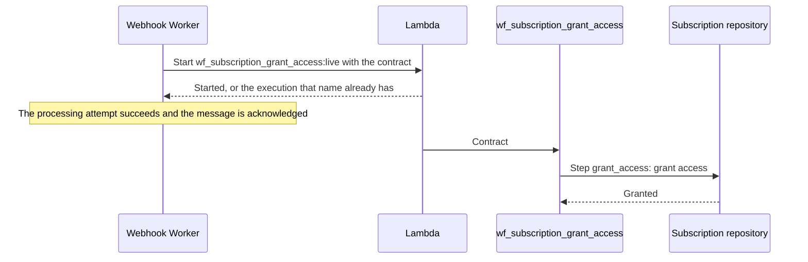

# Access grants

A payment that succeeds grants access to the subscription it bills. Granting is a business effect: the worker starts the `subscription_grant_access` durable workflow with a business contract, and the workflow grants access through the subscription repository. Subscriptions are not stored yet, so that repository is a placeholder that grants every request; see [Subscription storage](#subscription-storage). [Event ordering and retries](ordering-and-retries.md) states the rules business effects follow.

## Rule

| Event | Effect |
|---|---|
| A payment event whose status is `succeeded` and that names the subscription it bills | Grants access to that subscription |
| Any other event | None; revoking access is not built |

The status is the provider-neutral one receipt maps from each provider's event type, so every gateway grants access under the same rule; see [Out-of-order events](webhook-receipt.md#out-of-order-events).

> **Note:** Which events grant, suspend, restore, or revoke access is an open [business question](../requirements.md#7-business-requirements-to-clarify). Granting on a succeeded payment is the assumption until it is answered.

## Contract

The worker translates the event into the workflow's input, so the workflow depends on the business objects it acts on, not on webhook storage. Workflow inputs are JSON with snake_case keys:

```json
{
  "provider": "gatewayBrazil",
  "subscription_id": "sub_1",
  "payment_id": "pay_1",
  "metadata": {
    "event_id": "evt_1",
    "received_at": "2026-10-26T10:39:47.000Z"
  }
}
```

| Field | Meaning |
|---|---|
| `provider` | The gateway whose IDs these are, since IDs are unique only within a provider |
| `subscription_id` | The subscription that gains access |
| `payment_id` | The payment that paid for it |
| `metadata.event_id` | The event that caused the grant |
| `metadata.received_at` | When that event was received, in ISO 8601 UTC |

Every field is required and none may be blank. The customer is not part of the contract until the platform has its own users.

## How it works



| Component | Responsibility |
|---|---|
| Process use case | Builds the contract for each event the rule matches and starts the workflow, after the gateway adapter's `process`, inside the event's processing attempt |
| Workflow starter | Sends the contract as snake_case JSON, invoking the workflow's durable function `wf_<workflow>` asynchronously through its `live` alias, and names the execution after the workflow and its input |
| Durable driving adapter | Validates the input against the controller's schema and makes the execution's durable context available to the use case |
| Grant controller | Accepts only the contract, converting its keys and times for the use case |
| Grant use case | Runs one `grant_access` step that grants access from the contract alone, and logs `subscription_access_granted` |
| Durable execution adapter | Runs each step on the Lambda durable execution, retrying it and logging each failure |
| Subscription repository | Grants access; a placeholder for now |

The use case is a [durable use case](code-structure.md#durable-use-cases): it defines its steps, and the controller only checks its input.

## Subscription storage

Subscriptions belong in a relational database, since they relate to customers, plans, and payments. Its shared infrastructure belongs in `src/infra/sql/`, and its repositories live with the others in `src/infra/repositories/`. The database is not set up yet, so the SQL subscription repository grants every request without storing or checking anything:

- No access record is written, and no effect is recorded on the causing event.
- A grant does not check the payment's latest status, so a payment that arrives after its refund still grants access.
- The function has no database configuration or permissions.

## Retries and failures

| Failure | Handling |
|---|---|
| The workflow could not start | The worker's processing attempt fails, and SQS retries the message up to 5 receives before the dead-letter queue |
| The step fails | The step retries with delays that start at 5 seconds and double up to 10 minutes, each shortened by up to half at random. Its 32 attempts span about 2 to 4 hours, then the execution fails |
| The input does not match the contract | The execution fails with `WORKFLOW_INVALID_INPUT` before the use case runs |
| The same contract starts the workflow again | Lambda returns the existing execution while it is retained, 14 days; a later start runs the workflow again |

Each failed step attempt is logged as `workflow_step_error` with the step's name and the [error fields](code-structure.md#errors). A grant that never completes stays visible as a failed execution, while the event's processing status stays `processed`, because the worker's attempt covers only starting the workflow.

## Deployment

| Setting | Value | Reason |
|---|---|---|
| Durable execution | Execution timeout of 1 day and retention of 14 days | The timeout outlasts the step's retries, and retention keeps repeated starts deduplicated |
| Versions | A version is published on each deploy, and the `live` alias follows the newest | An execution resumes on the version that started it, while new executions use new code |
| Function name | `wf_subscription_grant_access`, started as `wf_subscription_grant_access:live`, a name the worker derives from the workflow's | Durable executions start only through a version or alias, and the `wf_` convention needs no configuration per workflow |
| Function permissions | Checkpoint and read the state of its own executions | Only what its execution needs |
| Worker permissions | Invoke the function through its alias only | The worker cannot start executions on other versions |

Durable execution can only be enabled when a function is created, so Terraform replaces a function whose durable configuration is added or removed. Locally, SAM runs the workflow with its durable execution emulator; see [Development](../guides/development.md#local-functions).

## Limitations

- The subscription repository is a placeholder: it stores no access and grants every request; see [Subscription storage](#subscription-storage).
- Revoking access is not built.

## Rejected alternatives

| Alternative | Why not |
|---|---|
| Starting the workflow with the event's identity, for the workflow to read the event | It ties the workflow to webhook storage and the event's shape, while a business contract keeps it independent of how the cause arrived |
| Granting from the worker without a workflow | A long outage would spend the message's 5 receives, about 15 minutes, while the workflow retries for hours on its own |
| Storing subscriptions in the webhook events table | Subscriptions relate to customers, plans, and payments, which a relational database models directly, while the table is keyed for events |
