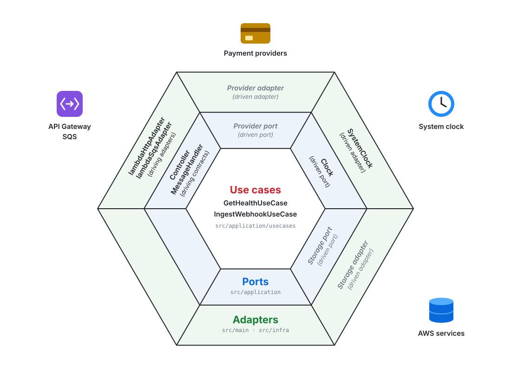
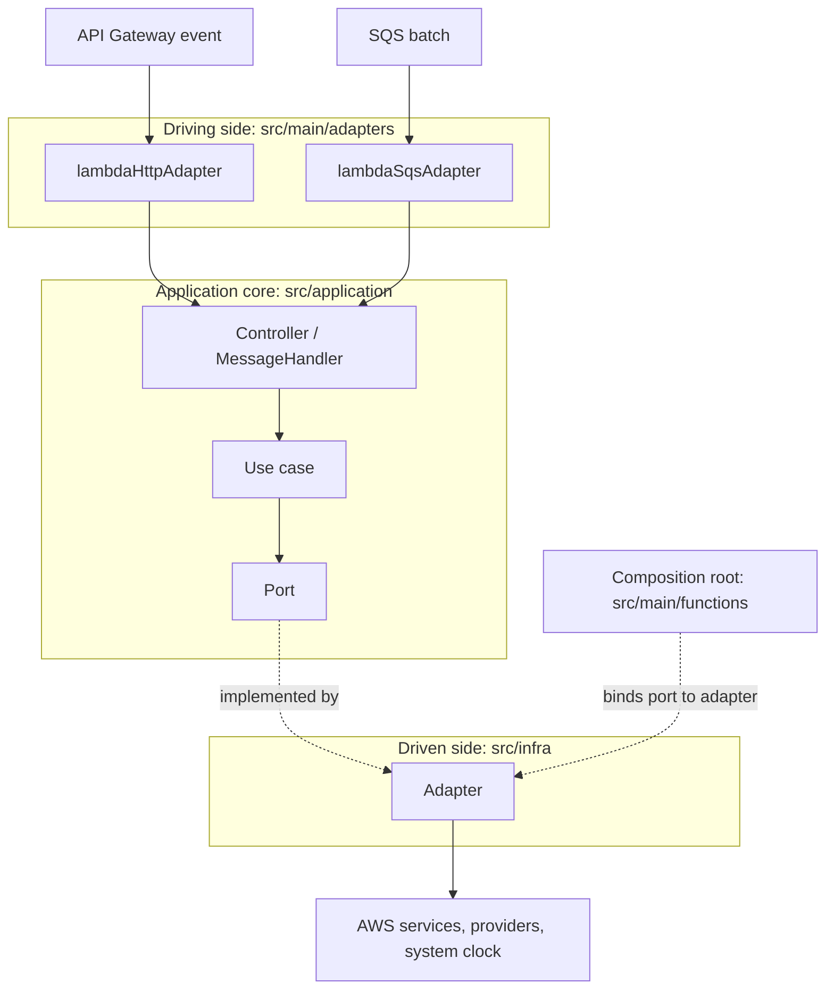
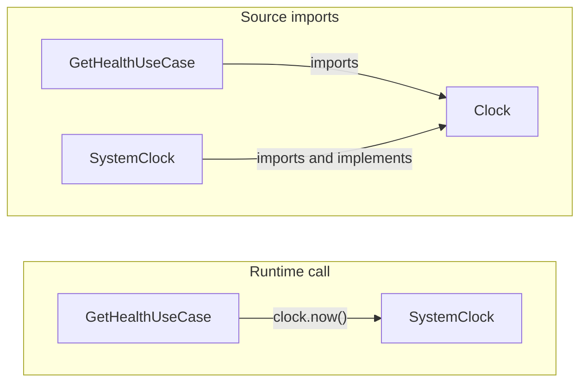
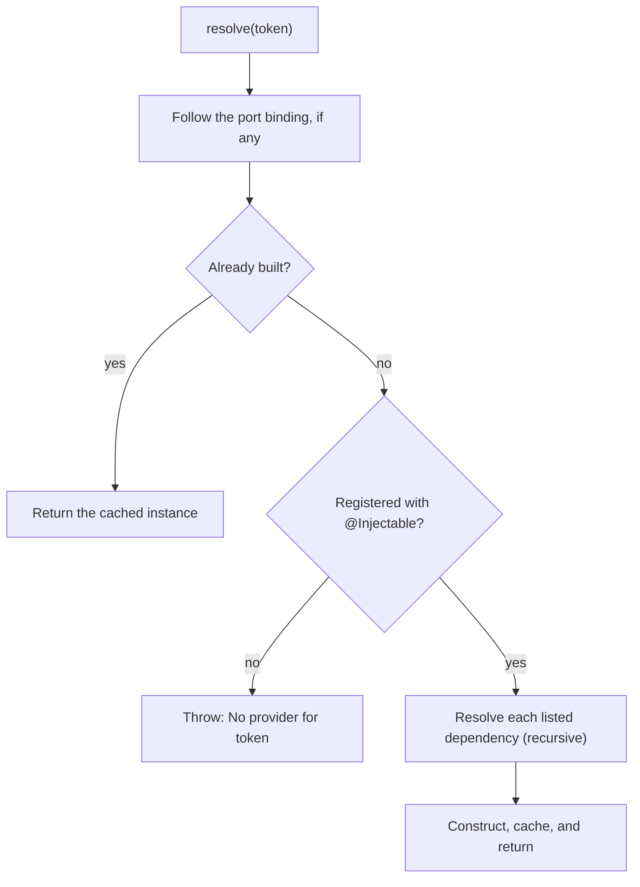

# Code structure

How the Lambda code is organized: a hexagonal (ports and adapters) structure with dependency injection. Business logic depends only on ports it defines, and AWS services, payment providers, and the Lambda runtime are adapters at the edges, so each can change without touching the business rules. See [Adding a Lambda](../guides/adding-a-lambda.md) for the step-by-step workflow.

## Hexagonal model

Driving adapters turn platform events into calls on the core. Whenever the core needs something from outside, it calls a port, and a driven adapter implements that port. Each function's entry file is its composition root: it decides which adapter backs each port.



The two inner rings live in `src/application`; the outer ring is split between `src/main/adapters` on the driving side and `src/infra` on the driven side. `lambdaHttpAdapter` uses the `Controller` contract and `lambdaSqsAdapter` uses `MessageHandler`; these contracts are the driving ports. The abstract classes in `application/ports/` are the driven ports. Gray italic segments are examples of port categories rather than existing classes.

A request travels from the platform event through the core to the outside world:



The [health function](../../src/main/functions/health.ts) is the reference example: `GetHealthController` calls `GetHealthUseCase`, which reads the time through the `Clock` port implemented by `SystemClock`.

## Layers

| Directory | Contains | May import |
|---|---|---|
| `src/application/` | Use cases, controllers, ports, contracts, and errors | `application`, `kernel` |
| `src/infra/` | Driven adapters that implement ports | `application`, `kernel` |
| `src/main/` | Driving adapters for Lambda events and one entry file per function | Any layer |
| `src/kernel/` | Dependency injection and the helpers every layer can use | `kernel` |

Imports use the `tsconfig.json` path aliases `@application/*`, `@infra/*`, `@kernel/*`, and `@main/*`. The import rules are not enforced by tooling; keep `infra` and `main` imports out of `application` during review.

| Path | Responsibility |
|---|---|
| `application/usecases/<area>/` | One business operation per class; depends on ports and other application code |
| `application/ports/` | Abstract classes describing what the core needs from outside, such as time, storage, or providers; ports of one area share a folder, such as `ports/webhooks/` |
| `application/controller/<area>/` | Declares the schema of its request body or queue message and calls a use case, or a port directly when that port performs the whole operation, such as the webhook worker routing through the provider registry |
| `application/contracts/` | Shapes shared across layers, such as `Controller` and `MessageHandler` |
| `application/errors/` | Error codes and the base classes mapped to responses |
| `infra/<concern>/` | Adapter classes implementing ports, grouped by concern, such as `infra/clock/`, `infra/logging/`, `infra/webhooks/`, or `infra/repositories/<entity>/` |
| `infra/<service>/` | Shared clients and helpers for one external service, such as `infra/dynamodb/`; they implement no port and are reused by adapters |
| `infra/config/` | `AppConfig` and its environment schema; see [Configuration](#configuration) |
| `main/adapters/` | Converts Lambda events into controller calls, validating payloads against the handler's schema, and maps results and errors to HTTP responses or SQS batch failures |
| `main/utils/` | Helpers shared by driving adapters, such as parsing request bodies and building responses |
| `main/functions/` | One entry per Lambda: binds ports to adapters and exports `handler`; entries of one area share a folder, such as `functions/webhooks/` |
| `main/bindings/` | Groups of port bindings that several entries share, one module per group; see [Binding several ports](#binding-several-ports) |
| `kernel/di/`, `kernel/decorators/` | The dependency injection registry, `@Injectable`, and `@Schema` |
| `kernel/utils/` | Helpers shared by every layer, such as parsing JSON, reading headers, comparing credentials, and the project's zod; one module per concern |

## Dependency direction

Calls flow outward at runtime, but source imports point inward: `infra` imports the ports it implements, and `application` never imports `infra`. This is the Dependency Inversion Principle.



Classes never construct their own dependencies; the composition root and the registry build and supply them. This inversion of control is what lets an entry swap one adapter for another without touching the core.

## Ports and contracts

A driven port is a contract only: an abstract class with abstract members that describes what the core needs, in the core's terms. [`Clock`](../../src/application/ports/Clock.ts) is the reference.

| Rule | Reason |
|---|---|
| Use an abstract class, not an interface | Abstract members are erased, but the class remains at runtime as the DI token |
| Declare only abstract members; put related types in a namespace of the same name | Adapters use `implements`, which inherits nothing, so concrete members would never reach them |
| Name operations by what the core needs, such as `now()` | Vendor operations and SDK types tie the core to one provider |
| Keep each port to one concern | Small ports are easier to fake in tests and to implement per provider |

Use cases receive ports through their constructors, so a unit test can pass a fake directly, such as `new GetHealthUseCase(fixedClock)`, without the registry.

`application/contracts/` holds a different kind of contract:

| | `application/ports/` | `application/contracts/` |
|---|---|---|
| Describes | What the core needs from outside | Shapes shared across layers, such as `Controller` |
| Form | Abstract class | Interface or type |
| Implemented by | Adapters in `src/infra/` | Application code, such as controllers |
| Used as a DI token | Yes, through a binding | No |

## Types that belong to a class

Declare the types a class owns, such as its inputs, outputs, and the shapes it stores, in an exported namespace with the same name, placed after the class. Callers then write `GetHealthUseCase.Output`, so every use names the owning class and needs no extra import.

```ts
export class GetHealthUseCase {
  async execute(): Promise<GetHealthUseCase.Output> {
    // ...
  }
}

export namespace GetHealthUseCase {
  export type Output = { status: "ok"; checkedAt: string };
}
```

| Type | Where it goes |
|---|---|
| Owned by one class, including shapes only that class uses | The class's namespace |
| Shared across layers, such as the `Controller` request and response | `application/contracts/` |
| Helper for a standalone function or decorator | Module level, next to the function |
| zod schema of a payload | Module level, above the class when `@Schema` declares it, since decorators run while the class is being defined; its type is `z.output` of the schema; see [Payload validation](#payload-validation) |

## Dependency injection

Classes register themselves with `@Injectable`, listing their constructor dependencies in order. TypeScript rejects a list that does not match the constructor, so a mismatch fails `npm run build`. esbuild compiles the project's standard decorators but cannot emit constructor type metadata, so the explicit list replaces it.

```ts
@Injectable(Clock)
export class GetHealthUseCase {
  constructor(private readonly clock: Clock) {}
}
```

### Concrete classes and ports

A dependency is either a concrete class, which resolves directly, or a port, which needs a binding. Make a dependency a port when the core needs it from outside, or when it may change per provider, environment, or test.

| Dependency | Example | Wiring |
|---|---|---|
| Core to core | `GetHealthController` → `GetHealthUseCase` | Concrete class; no binding |
| Infra to infra | A repository adapter → the shared DynamoDB client wrapper | Concrete class; no binding |
| Core to outside | `GetHealthUseCase` → `Clock` | Port bound to an adapter in the entry file |
| Core to infra adapter | A use case importing `SystemClock` | Not allowed; add a port |

### Composition root

Each function's entry file binds its ports, then resolves its controller and the logger its driving adapter uses:

```ts
const registry = Registry.getInstance();
bindRuntime(registry);
bindWebhooks(registry);
registry.bind(WebhookEventDispatcher, SqsWebhookEventDispatcher);

export const handler = lambdaHttpAdapter(
  registry.resolve(WebhookEntryPointController),
  registry.resolve(Logger),
);
```

`resolve` builds the graph depth first and caches every instance:



| Behavior | Detail |
|---|---|
| When the graph is built | Once, when the module loads in a new execution environment |
| Instance scope | One shared instance per class for the environment's lifetime, so clients and their connections are reused across invocations; keep per-request state out of injected classes |
| Binding location | In each function's entry, so its bundle includes only the adapters it uses |
| Missing binding | `resolve` throws `No provider for <Port>` during initialization |
| Circular import | `@Injectable` throws `<Class> dependency #<n> is undefined` when the module loads |

### Binding several ports

An entry binds only the ports its graph reaches, so its bindings list every external dependency of the function. When the same group repeats across functions, move it into a function in its own module under `src/main/bindings/` and call it from each entry. [`bindWebhooks`](../../src/main/bindings/webhooks.ts) is the reference example: both webhook functions bind the provider registry and the event repository through it, and `bindRuntime` binds the clock and logger every function uses.

| Rule | Reason |
|---|---|
| Keep each group to adapters that every caller uses | Anything extra is bundled into functions that never call it |
| Give each group its own module | `@Injectable` runs when a module loads, so the bundler keeps every adapter a module imports, even for a group the entry never calls |

| Avoid | Why |
|---|---|
| One global bootstrap that binds every port | Every bundle includes every adapter and its SDK clients |
| Adapters registering themselves as a port's default | Bindings depend on import order, and two adapters for one port overwrite each other silently |

A missing binding fails only when the entry loads. A build test loads every registered entry from its production bundle, so `npm test` catches it.

## Payload validation

Payloads are validated with zod schemas instead of inline type checks, so each payload's shape is declared once and its TypeScript type is derived from it. A controller or queue handler declares the schema of its request body or message with `@Schema`, and the driving adapter validates every payload against it before calling `handle`. The [webhook worker](../../src/application/controller/webhooks/WebhookWorkerController.ts) is the reference example:

```ts
const messageSchema = z.object({ provider: identifier, providerEventId: identifier });

@Injectable(WebhookProviderRegistry)
@Schema(messageSchema)
export class WebhookWorkerController implements MessageHandler {
  async handle(message: WebhookWorkerController.Message): Promise<void> {
    await this.providerRegistry.route(message);
  }
}

export namespace WebhookWorkerController {
  export type Message = z.output<typeof messageSchema>;
}
```

| Rule | Reason |
|---|---|
| Declare the schema at module level, above the class | Decorators run while the class is being defined, before the class and its namespace exist |
| Type the payload as `z.output` of the same schema | The type and the runtime check cannot drift apart |
| Express every requirement in the schema, such as `z.minLength`, `z.regex`, `z.refine`, or `z.transform`, and do not re-check fields in `handle` | All the rules a payload must meet stay in one place, and the handler reads only the schema's output, with defaults and transforms applied and undeclared fields dropped |
| Driven adapters that read external payloads, such as a provider's webhook body, parse them with a module-level schema and `safeParse` | The same declarative checks apply where no driving adapter runs, and each adapter maps a failure to its port's result, such as `undefined` from `parse` |

| Transport | Validated payload | When it does not match |
|---|---|---|
| HTTP | The parsed JSON body | `ErrorHttpInvalidBody`: `400` with `HTTP_INVALID_BODY`, expected, listing each issue in the message |
| SQS | The parsed message body | `ErrorQueueInvalidMessage`: `QUEUE_INVALID_MESSAGE`, unexpected, retried like any failure |

A handler without `@Schema` receives the payload unchanged. Issue messages name the field and what was expected rather than the received value, so payment data stays out of responses and logs.

### zod/mini

Every schema uses zod/mini, zod's tree-shakable build, imported as `import * as z from "@kernel/utils/zod"`. Bundle size decides the choice: zod is most of each webhook function's bundle, and Lambda loads the whole bundle on every cold start.

| | Regular zod | zod/mini |
|---|---|---|
| What a bundle includes | Most of the library as soon as one schema exists, since every schema carries every method | Only the checks its schemas use, since each check is a separate function |
| zod in each webhook bundle | About 95 KB of a 111 KB bundle | About 24 KB of a 43–46 KB bundle, including English messages |
| Syntax | `z.string().min(1)`, `.optional()`, `.refine(...)` | `z.string().check(z.minLength(1))`, `z.optional(...)`, `.check(z.refine(...))` |

| Rule | Reason |
|---|---|
| Import zod only through `@kernel/utils/zod`; a test fails on any direct `zod` import | A single import of regular zod puts all of it back into that function's bundle |
| `@kernel/utils/zod` loads the English locale | zod/mini reports every issue as "Invalid input" until a locale is loaded |
| The English locale is imported on its own rather than through `z.locales` | The `z.locales` namespace bundles every language, about 260 KB |

## Configuration

Adapters read environment variables through `AppConfig`, injected like any other dependency. Its [zod/mini](#zodmini) schema declares each variable under the group of code that uses it, such as the webhook providers' credentials, and `AppConfig` exposes each group as typed, named settings. The schema must match the variables Terraform gives each function; see [Environment variables](../guides/adding-a-lambda.md#environment-variables).

| Behavior | Reason |
|---|---|
| A group is validated when it is read, not when the function starts | A function needs only the variables of the groups it uses, and a missing or invalid variable fails only the requests that need it, with an error naming the variable |

## Logging

Lambda code logs only through the `Logger` port, never `console`, so every function's entries share one shape and can be queried together. Each entry names a message from the catalog in the port's namespace, which TypeScript enforces, so a new kind of entry is added to the catalog before it is logged. `JsonLogger` writes each entry as one JSON line on stdout:

```json
{"timestamp":"2026-10-15T10:00:00.000Z","level":"INFO","message":"webhook_routed","lambdaRequestId":"8f5c...","messageId":"4d1a...","messageGroupId":"gatewayGlobal","receiveCount":"1","eventSourceARN":"arn:aws:sqs:...","provider":"gatewayGlobal","providerEventId":"evt_1","eventType":"payment.succeeded"}
```

| Field | Value |
|---|---|
| `timestamp` | When the entry was logged, from the `Clock` port, in RFC 3339 |
| `level` | `DEBUG`, `INFO`, `WARN`, or `ERROR` |
| `message` | The entry's name from the catalog, in snake case, such as `webhook_routed` |
| Context fields | Added by the driving adapter to every entry logged during the invocation |
| Entry fields | What the caller passes; undefined fields are left out |

| Context field | Added by | Value |
|---|---|---|
| `lambdaRequestId` | Both driving adapters | The invocation's Lambda request ID, which Lambda's own records of the invocation, such as its report, also carry |
| `requestId`, `route` | `lambdaHttpAdapter` | API Gateway request ID and route key |
| `messageId`, `messageGroupId`, `receiveCount`, `eventSourceARN` | `lambdaSqsAdapter` | The SQS message being handled: its ID, group, receive count, and source queue |

Context follows the async call chain, so code below the driving adapters, such as a gateway adapter, has its entries correlated without receiving the request, and concurrent invocations never share fields. Only entries logged through the same `JsonLogger` see a context, which holds because the registry builds one instance and injects it everywhere. Terraform gives every function Lambda's JSON log format: Lambda passes the lines through unchanged, writes its own records as JSON too, and sends only entries at `INFO` and above to CloudWatch.

| Rule | Reason |
|---|---|
| Log through `Logger`, never `console` | Every entry has the same fields and level names, which Lambda's level filtering reads |
| Never log payloads, credentials, or card data; log identifiers instead | Logs are kept and read more widely than the data they describe |
| Log errors with the shared [error fields](#errors), not as `Error` objects | JSON keeps neither an error's message nor its stack |

Tests read entries with `captureLogs` from the logger's fixtures, which silences stdout and parses each line.

## Errors

HTTP errors follow the mapping below. Both driving adapters log the same error metadata. The FIFO SQS adapter adds message ID, group, receive count, and queue ARN, then returns failed and unprocessed records for retry regardless of the error's status or kind; see [Webhook processing](webhook-processing.md#delivery-and-failures).

`lambdaHttpAdapter` parses JSON request bodies, validates them against the controller's schema, and returns JSON responses. Errors become `{ "success": false, "error": { "code", "message" } }`:

| Thrown | Use for | Response |
|---|---|---|
| `HttpError` subclass, such as `ErrorHttpBadRequest` | Failures of the request itself, raised before the controller is reached, such as a malformed JSON body or one that does not match the controller's schema | Its `statusCode`, code, and message |
| `ApplicationError` subclass | Failures raised from the controller down, such as a business rule a use case enforces | Its `statusCode`, code, and message |
| Anything else | Failures nobody anticipated, such as a storage outage or a defect | `500` with `INTERNAL_SERVER_ERROR`; details only in logs |

All defined errors extend `BaseError`, which sets `name` from the class name. HTTP transport errors extend `HttpError`, which sets the `http` category; queue transport errors live under `errors/queue/` and use the `queue` category. Errors raised from controllers, use cases, or domain adapters extend `ApplicationError` and belong in their area folder, such as `errors/application/webhooks/`:

| Detail | Meaning |
|---|---|
| `statusCode` | HTTP status of the response; ignored by the SQS adapter |
| `code` | Stable machine-readable code, from the `ErrorCode` enum |
| `category` | Area the error belongs to, from the `ErrorCategory` enum, such as `webhooks`, `http`, or `queue` |
| `kind` | `expected` when the error is part of normal operation, such as a forged webhook; `unexpected` when it needs attention, such as an event a supported provider sent that cannot be read |

Errors are named after their domain first, so codes and classes of one area sort together:

| Name | Pattern | Example |
|---|---|---|
| Code | `<DOMAIN>_<NAME>`, where the domain is the error's category in singular | `WEBHOOK_MALFORMED_EVENT`, `HTTP_BAD_REQUEST` |
| Class | `Error` followed by the code in PascalCase, in a file of the same name | `ErrorWebhookMalformedEvent`, `ErrorHttpBadRequest` |

`INTERNAL_SERVER_ERROR` has no domain, because it is the fallback for errors the application does not define. The abstract base classes `BaseError`, `HttpError`, and `ApplicationError` are never thrown and keep their names.

An error can be shared across receipt and processing while its kind varies by context. `ErrorWebhookProviderNotFound` defaults to expected for public requests; the registry's routing operation marks it unexpected because an accepted event should have a registered provider. Codes identify failures, while kinds describe whether they need investigation.

Every error caught by a driving adapter is logged as one `ERROR` entry, so monitoring can count errors by category, kind, and code. Errors during dependency initialization are reported by the Lambda runtime before the adapter runs.

| Field | Value |
|---|---|
| `message` | `application_error` for HTTP; `queue_message_error` for SQS |
| `category` | The error's category; absent for errors the application does not define, which the route and function still identify |
| `errorKind` | The error's kind; `unexpected` for errors the application does not define |
| `errorCode` | The error's code; `INTERNAL_SERVER_ERROR` for errors the application does not define |
| `errorName`, `errorMessage` | The error's class name and message |
| `errorStack` | Present only for unexpected errors |
| Context fields | The invocation's request or message; see [Logging](#logging) |
