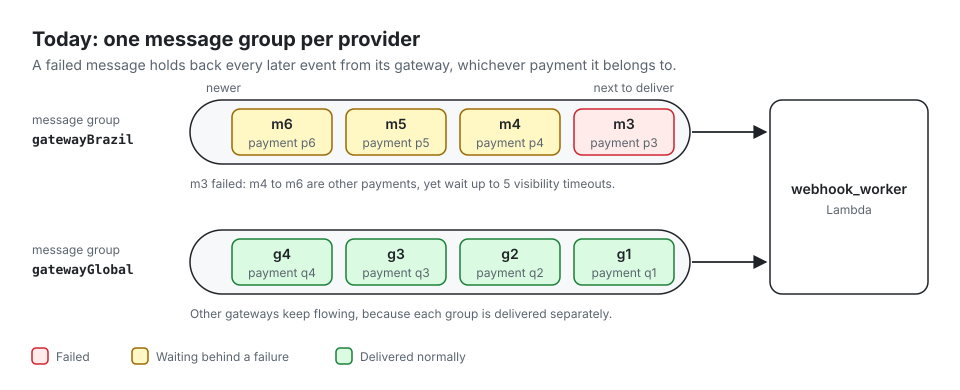
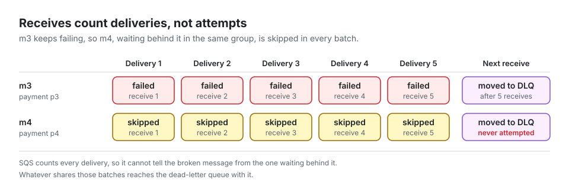
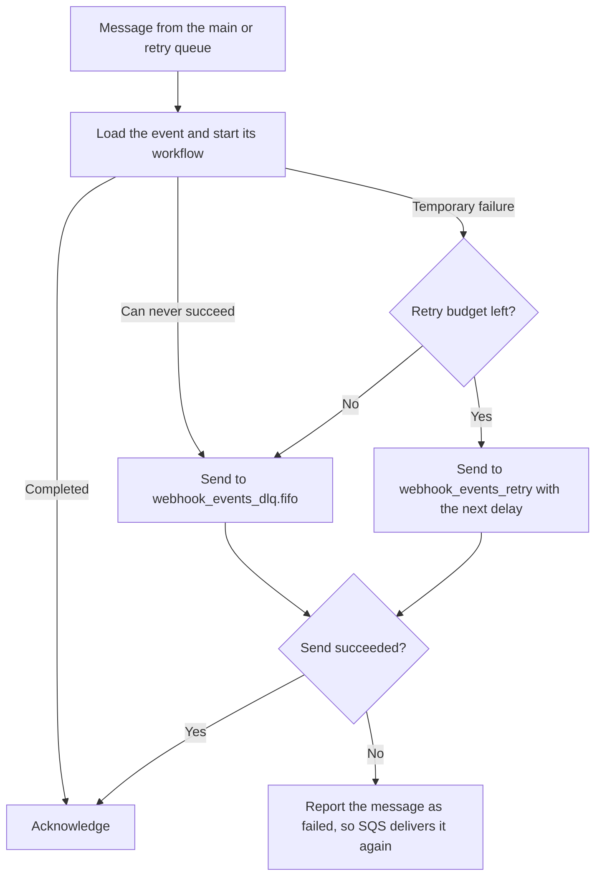
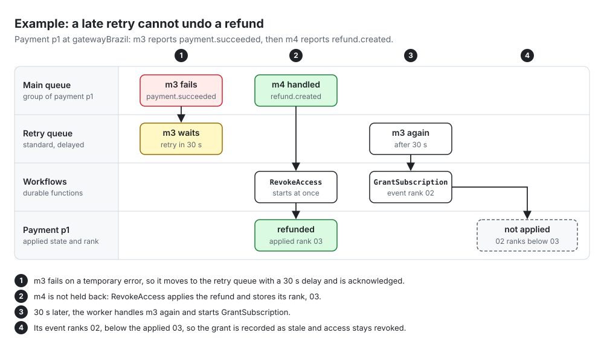

# Event ordering and retries

> **Status:** planned. This is the strategy the next processing changes implement; [Webhook processing](webhook-processing.md) describes how the worker behaves today.

Payment events change money and customer access, so the order in which their effects land matters: a grant that lands after a refund gives a customer access they no longer pay for. This document explains how processing keeps business outcomes in the right order while making sure one failing event never holds back the others, and why the design takes this shape.

## Summary

| Decision | Reason |
|---|---|
| One SQS FIFO message group per business subject, such as one payment, instead of one per provider | Only events about the same subject need order, so a failure no longer stalls a whole gateway |
| Business order is enforced where effects are written, by comparing event ranks | The queue orders events by receipt, and workflows can finish in any order, so the queue alone cannot guarantee the right outcome |
| A failed message leaves the FIFO queue for a delayed retry queue | A failure never blocks the messages behind it, and temporary failures recover without operators |
| Messages that can never succeed, and messages out of retries, are parked in a dead-letter queue at once | They stop consuming retries and alert operators |
| The worker starts one durable workflow per business action, named after the event | Long business steps retry on their own, and a repeated start never runs an action twice |

## Context

Receipt stores every valid webhook event in DynamoDB and sends its identity, the provider and the provider's event ID, to the `webhook_events.fifo` queue. The `webhook_worker` Lambda reads batches of up to 10 messages and processes each stored event; see [Webhook receipt](webhook-receipt.md#processing-queue) and [Webhook processing](webhook-processing.md).

Within one message group, an SQS FIFO queue guarantees:

| Guarantee | Consequence |
|---|---|
| Messages are delivered in the order they were sent | Events about the same subject usually arrive in receipt order |
| While a message is in flight, received but not yet deleted, no later message of its group is delivered | A failed message holds back its group until it is deleted or moved |
| A message that is not deleted becomes visible again after the visibility timeout, 180 seconds here, and every delivery adds to its receive count | After 5 receives, SQS moves it to the dead-letter queue |

The strategy must meet these [requirements](../requirements.md):

- Produce the correct final state regardless of arrival order, and never let an older event reverse a more recent outcome.
- Keep failing or invalid events from blocking unrelated ones, and one gateway's failures from blocking the others.
- Recover automatically from transient failures, including a two-hour downstream outage.
- Apply each business effect at most once, including during duplicate delivery and reprocessing.

## The problem

Today each provider is one message group, and a failed message holds back the rest of its group. That blocking costs a lot and buys little.

### One failure holds back a whole gateway

The group is the provider, so every `gatewayBrazil` event waits behind m3, although m4 to m6 are about other payments and do not depend on it. The worker already keeps handling other groups in the same batch, so `gatewayGlobal` is unaffected, but within `gatewayBrazil` nothing moves until m3 succeeds or reaches the dead-letter queue: five receives, each at least one 180-second visibility timeout apart, or about 15 minutes.

### Waiting messages reach the dead-letter queue without running

To keep the order, the worker skips the messages behind a failure in its group and reports them as failed, so SQS delivers them again later. SQS counts receives, not attempts, so every skip spends one of m4's receives. When m3 reaches the dead-letter queue, m4 goes with it, although it might have succeeded. Which messages end up there depends only on timing: whatever happened to share those batches with m3.

### Queue order is not business order

Even when nothing fails, the order of the queue is not the order of the business:

- The queue keeps the order in which webhooks were received, not the order in which events occurred. Providers deliver late and out of order, such as a refund before the payment it reverses; receipt already ranks such events, as [Out-of-order events](webhook-receipt.md#out-of-order-events) describes.
- Business work will run in durable workflows that take from seconds to hours. Two workflows started in queue order can finish in either order: a `RevokeAccess` started after a `GrantSubscription` can finish first.

Blocking therefore delays every event behind a failure without making the outcome correct. The order has to be enforced where effects are written, and the queue only needs to make out-of-order events rare.

## The strategy

### Message groups per subject

Each event's message group becomes its business subject, `{provider}#{subject_type}#{subject_id}`, the key that subject statuses and the `GSI2` index already use; see [Keys](data-model/webhook-events.md#keys). Provider IDs may contain characters SQS rejects in a group ID, so the group ID is a digest of that key, as the deduplication ID already is.

| Event | Subject | Message group |
|---|---|---|
| `payment.succeeded` for payment `p1` | Payment `p1` | `gatewayBrazil#payment#p1` |
| `refund.created` for payment `p1` | Payment `p1`, since a refund uses its payment's ID | `gatewayBrazil#payment#p1` |
| A cancellation of subscription `s1` | Subscription `s1` | `gatewayGlobal#subscription#s1` |
| An event that names no subject | The event itself | `{provider}#{provider_event_id}`, so it waits for nothing |

Events about one payment still arrive in order in most cases, while different payments, subscriptions, and gateways never wait for each other.

### Order enforced by rank

Receipt already ranks each event that reports a payment's status, by status precedence, then occurrence time, then event ID, and records the latest one per subject in a conditional write; see [Out-of-order events](webhook-receipt.md#out-of-order-events) and [Event order](data-model/webhook-events.md#event-order). Processing applies the same rule where effects are written:

- A step that changes a subject's state, such as a payment's recorded status, also stores the rank of the event that changed it.
- The step writes only if its event ranks higher than the stored rank, in one conditional write, so a concurrent or late step cannot overwrite a newer outcome.
- State that depends on several subjects, such as a customer's access to a subscription, is recomputed from those subjects' applied states rather than changed by each event, so it follows the same order.
- An event that ranks lower is not an error. Its effect is recorded as stale, so the event's history shows why nothing changed, and facts that do not depend on order, such as the amount a payment charged, are still recorded.
- Each effect carries an idempotency key, its `business_key`, so a step that runs twice writes once; see [Effect](data-model/webhook-events.md#effect).

Because the rank decides the outcome, the order in which messages are processed, retried, or redriven can no longer make the final state wrong. That is what makes it safe to stop blocking.

### Failures leave the FIFO queue

When a message fails, the worker sends it to another queue and then acknowledges the original, so nothing in its group stays in flight:

| Outcome | Examples | What the worker does |
|---|---|---|
| Completed | The workflow started, or the event was already processed | Acknowledges the message |
| Temporary failure | DynamoDB throttling, a throttled workflow start, `WEBHOOK_EVENT_IN_PROGRESS`, or an unclassified `INTERNAL_SERVER_ERROR` | Sends it to `webhook_events_retry` with the next delay, then acknowledges it |
| Permanent failure | `QUEUE_MALFORMED_MESSAGE`, `QUEUE_INVALID_MESSAGE`, `WEBHOOK_EVENT_NOT_FOUND`, or `WEBHOOK_PROVIDER_NOT_FOUND` | Sends it to `webhook_events_dlq.fifo`, then acknowledges it |
| Retry budget spent | A temporary failure that outlasted the budget | Sends it to `webhook_events_dlq.fifo`, then acknowledges it |
| The send fails | SQS cannot be reached | Reports it in `batchItemFailures`, so SQS delivers it again from its queue |

The worker acknowledges a message only after the send succeeds, so a message is never lost; the worst case is a duplicate, when the worker stops between the send and the acknowledgment. Duplicates are harmless: a processed event is acknowledged without another attempt, a running attempt refuses a second one, and a repeated workflow start returns the existing execution.

The retry queue is a standard queue because only standard queues accept a delay per message; a FIFO queue can only delay all its messages alike. It keeps no order, and needs none, since the rank decides the outcome.

### Retry schedule

| Retry | Delay before it |
|---|---|
| 1st | 30 seconds |
| 2nd | 2 minutes |
| 3rd | 8 minutes |
| Each later one | 15 minutes, the longest delay SQS allows for one message |

- Each delay is shortened at random by up to 20%, so messages that failed together during an outage do not all return at the same moment.
- Retries continue until 6 hours after the first failure, about 27 retries, which covers the [two-hour outage target](../requirements.md#5-non-functional-requirements) with margin. The schedule and the budget are configuration.
- Each retry carries its retry number and the time of its first failure as message attributes, since an invalid message may name no stored event that could count them. The processing attempts stored in DynamoDB remain the history of each try.

### Dead-letter queues

| Queue | Receives | Operators |
|---|---|---|
| `webhook_events_dlq.fifo` | Messages the worker parks, and main-queue messages SQS moves after 5 receives | An alarm fires when it holds a message; after fixing the cause, operators redrive it to `webhook_events.fifo`, which starts a new retry budget |
| `webhook_events_retry_dlq` | Retry-queue messages SQS moves after 5 receives, because the worker never answered for them | An alarm fires when it holds a message; operators redrive it to `webhook_events_retry` |

SQS requires a dead-letter queue of the same type as its source, so the standard retry queue needs a standard one. The worker parks every message in the FIFO dead-letter queue, so operators normally work with a single queue; the second exists only for crashes and timeouts on the retry path.

The redrive after 5 receives stays on both queues as a safety net for failures the worker never sees, such as a function timeout, an initialization error, or a crash. The whole batch then returns after the visibility timeout, the only case in which a group still waits.

### Durable workflows do the business work

The worker stays small: it loads the event, chooses its business action, such as `GrantSubscription` or `RevokeAccess`, and starts a [Lambda durable function](https://docs.aws.amazon.com/lambda/latest/dg/durable-functions.html) for it. Durable functions checkpoint each step, retry failed steps, and suspend during waits without compute charges, which suits business work that calls other services and may need hours to recover.

- **Starts are idempotent.** The execution name is a digest of the provider, the event ID, and the action, and the input is the event identity alone. Lambda treats a start with an existing name and the same input as the same execution, so duplicates and retries never run an action twice; see [Idempotency](https://docs.aws.amazon.com/lambda/latest/dg/durable-execution-idempotency.html). SQS event source mappings cannot pass an execution name, so the worker acts as the dispatcher that AWS recommends for this.
- **Steps run at least once.** A step can repeat after an interruption, so each one writes with its effect's idempotency key and its rank condition.
- **Each failure has one owner.** The worker's processing attempts cover starting the workflow, and the execution's status covers the business result.

| Failure | Handled by | Recovery |
|---|---|---|
| The workflow could not start | The worker and the retry queue | Delayed retries for up to 6 hours, then the dead-letter queue |
| A business step failed after the start | The workflow | Step retries with backoff, which also outlast a two-hour downstream outage; a failed execution stays visible with what completed and what remains |

## How the strategy handles each case

### A late retry cannot undo a refund

m3 and m4 are about the same payment, so they share a message group. m3 fails on a temporary error, but instead of holding m4 back, it moves to the retry queue. m4 runs at once and records the refund. When m3 returns 30 seconds later, its grant still runs, but its event ranks lower than the refund, so the conditional write refuses it and the customer keeps no access. Before this strategy, m4 would have waited behind m3, and might have reached the dead-letter queue without running. The diagram shows only the precedence part of each rank.

### Other cases

| Case | What happens |
|---|---|
| A refund arrives before its payment | Receipt ranks the refund higher, and the payment arrives outdated. Its grant step fails the rank condition, so no access is granted, while the payment's amount is still recorded |
| A malformed or invalid message | It is parked at once in the dead-letter queue, which raises an alarm; the rest of its batch and its group continue |
| A defect fails every event of one type | Each event retries for up to 6 hours, then is parked. After the fix, operators redrive the dead-letter queue, and the rank keeps the late events from overwriting newer outcomes |
| A downstream service is down for two hours | The workflows started normally; their steps keep retrying with backoff and complete when the service returns, without operators |
| DynamoDB or Lambda is briefly unavailable to the worker | The workflow cannot start, so the message retries from the retry queue while other subjects continue |
| The worker crashes during a batch | SQS delivers the batch again after the visibility timeout. Processed events are acknowledged and started workflows are reused; repeated crashes reach the dead-letter queue after 5 receives |
| The same event is delivered twice | The queue drops a repeat within five minutes. Later repeats find the event processed or the named workflow already started |

## Trade-offs

- **Retries run out of queue order.** This is accepted because the rank decides the outcome; the FIFO queue still delivers most events of a subject in order, which keeps stale events rare.
- **More moving parts.** One more queue, a second dead-letter queue, their alarms, and a worker that also sends messages through a driven port.
- **Duplicates are expected.** Sending before acknowledging, and steps that run at least once, require every write to be idempotent, which the requirements demand anyway.
- **Unanswered batches still wait.** A crash or timeout holds its groups for one visibility timeout per delivery.
- **Delays are short.** SQS delays one message for at most 15 minutes, so longer waits take several retries; a business wait that needs more belongs in a workflow.

## Requirements coverage

| Requirement | Met by |
|---|---|
| Correct final state regardless of arrival order | Rank conditions on every state change |
| An older event never reverses a newer outcome | Rank conditions, and state derived from applied ranks |
| Failing or invalid events do not block unrelated ones | Groups per subject, failed messages leaving the FIFO queue, and invalid messages parked at once |
| One gateway's failures do not block another | Message groups never span gateways |
| Automatic recovery from transient failures and a two-hour outage | The retry queue's 6-hour budget and the workflows' step retries |
| Each effect at most once | Idempotent workflow starts, effect idempotency keys, and the processed status |
| Permanently incomplete operations are visible | Dead-letter queues with alarms, and failed workflow executions |
