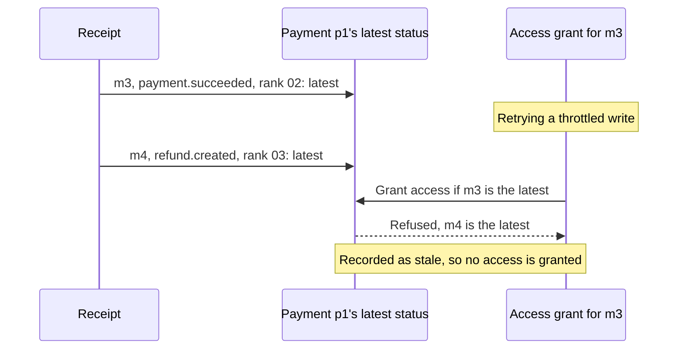

# Event ordering and retries

Processing keeps each business subject's events in order, confines a failure to the subject it belongs to, and leaves the final business state to the events' ranks rather than to queue order. This page states those rules and the reason for each; [Webhook processing](webhook-processing.md) describes the worker that applies them.

## Rules

| Rule | Reason |
|---|---|
| Each business subject, such as a payment, has its own SQS FIFO message group | Only events about the same subject depend on each other, so a failure holds back one subject and processing scales with the number of subjects |
| A business effect applies only while its event is its subject's latest, as receipt ranks them | The queue knows the order webhooks arrived in, not the order events occurred in, and workflows finish in any order |
| A temporary failure is retried in place and holds back only its own subject | Its subject's later events usually depend on the same failing dependency, and waiting keeps them in order |
| A message that can never succeed is parked in the dead-letter queue at once | It stops holding back its subject and alerts operators |
| Business work runs in durable workflows that retry their own steps | Long downstream outages are absorbed where the work happens, so the queue only absorbs short failures |

Message groups, retries, and parking apply to every event. Granting a subscription's access is the first business effect, and it runs in a durable workflow, but subscriptions are not stored yet, so it grants without checking the payment's latest status; see [Access grants](access-grants.md#subscription-storage).

## Queue guarantees

The rules rely on what an SQS FIFO queue guarantees within one message group:

| Guarantee | Consequence |
|---|---|
| Messages are delivered in the order they were sent | A subject's events arrive in receipt order |
| While a message is in flight, received but not yet deleted, no later message of its group is delivered | A failed message holds back its group until it is deleted or moved |
| A message that is not deleted becomes visible again after the visibility timeout, 180 seconds here, and every delivery adds to its receive count | After 5 receives, SQS moves it to the dead-letter queue |

## Message groups

Receipt sends each event to the message group of its business subject, `{provider}#{subject_type}#{subject_id}`, the key that subject statuses and the `GSI2` index also use; see [Keys](data-model/webhook-events.md#keys). The group ID is a digest of that key, since provider IDs may contain characters SQS rejects in a group ID.

| Event | Subject | Message group |
|---|---|---|
| `payment.succeeded` for payment `p1` | Payment `p1` | `gatewayBrazil#payment#p1` |
| `refund.created` for payment `p1` | Payment `p1`, since a refund uses its payment's ID | `gatewayBrazil#payment#p1` |
| A cancellation of subscription `s1` | Subscription `s1` | `gatewayGlobal#subscription#s1` |
| An event that names no subject | The event itself | `{provider}#{provider_event_id}`, so it waits for nothing |

A FIFO queue delivers each group one batch at a time, so the group is the unit of both ordering and parallelism. A subject receives only a few events in its lifetime, so at high volume nearly every message has a group of its own: the queue runs almost as parallel as a standard queue, and keeps order only where it matters.

## Order of business effects

Receipt ranks each event that reports a payment's status, by status precedence, then occurrence time, then event ID, and records the latest one per subject in a conditional write; see [Out-of-order events](webhook-receipt.md#out-of-order-events) and [Event order](data-model/webhook-events.md#event-order). Business effects follow that ranking:

- A step that changes state checks, in the same transaction, that its event still reports its subject's latest status, so a concurrent or late step cannot overwrite a newer outcome.
- The latest event's own effect always runs, so the subject's final state follows it.
- An event that is outranked is not an error. Its effect is recorded as stale, so the event's history shows why nothing changed.
- Each effect carries a `business_key` linking it to the record it changed, and writing it again for the same event rewrites the same items, so a step that runs twice changes nothing; see [Effect](data-model/webhook-events.md#effect).

The latest status, not the queue, decides the final state, so the order in which messages are processed or redriven, or in which workflows finish, cannot make it wrong.

In the following example, m3 reports `payment.succeeded` and m4 `refund.created` for the same payment. They share a message group and arrive in order, but m3's workflow is still retrying when m4 is received:

The grant runs after the refund was received, so it cannot grant access the refund reversed. The diagram shows only the precedence part of each rank.

## Failures

| Outcome | Examples | Handling |
|---|---|---|
| Completed | The workflow started, or the event was already processed | The message is acknowledged |
| Temporary failure | DynamoDB throttling, a throttled workflow start, `WEBHOOK_EVENT_IN_PROGRESS`, or an unclassified `INTERNAL_SERVER_ERROR` | The message and the later messages of its group in the batch are reported as failed. SQS delivers them again, in order, after the visibility timeout, and moves the failed one to the dead-letter queue after 5 receives |
| Permanent failure | `QUEUE_MALFORMED_MESSAGE`, `QUEUE_INVALID_MESSAGE`, `WEBHOOK_EVENT_NOT_FOUND`, or `WEBHOOK_PROVIDER_NOT_FOUND` | The worker parks the message in the dead-letter queue in its message group, then acknowledges it, so its group moves on |
| Parking fails | SQS cannot be reached | Handled as a temporary failure |

Each error declares whether it is `retryable`; see [Errors](code-structure.md#errors). Retrying in place holds back only the failed message's subject. Its later events would usually fail on the same dependency, and waiting keeps them in receipt order. Five receives over about 15 minutes absorb short failures, such as DynamoDB throttling or a function timeout; long downstream outages are retried inside the durable workflows.

### Dead-letter queue

`webhook_events_dlq.fifo` holds messages the worker parks because they can never succeed, and messages SQS moves after 5 receives. A parked message keeps its message group and carries `errorCode` and `receiveCount` attributes, so operators see why it is there without the logs. An alarm fires when the queue holds a message. After fixing the cause, operators redrive the queue to `webhook_events.fifo`, where each message rejoins its subject's group; see [Webhook processing](webhook-processing.md#dead-letter-queue).

## Durable workflows

The worker loads each event, calls its gateway adapter, and starts a [Lambda durable function](https://docs.aws.amazon.com/lambda/latest/dg/durable-functions.html) for each business action the event calls for, such as `wf_subscription_grant_access` for a succeeded payment. It passes each workflow a business contract built from the event, so workflows never read webhook storage. Durable functions checkpoint each step, retry failed steps, and suspend during waits without compute charges, which suits business work that calls other services and may need hours to recover. Each workflow is a [durable use case](code-structure.md#durable-use-cases) that defines its own steps.

- **Starts are idempotent.** The execution name is a digest of the workflow and its input, and the input names its causing event, so the same event always yields the same name and input. Lambda treats a start with an existing name and the same input as the same execution, so a repeated delivery never runs an action twice; see [Idempotency](https://docs.aws.amazon.com/lambda/latest/dg/durable-execution-idempotency.html). SQS event source mappings cannot pass an execution name, so the worker acts as the dispatcher AWS recommends for this.
- **Steps run at least once.** A step can repeat after an interruption, so each one rewrites the same items and checks its event's latest status.
- **Each failure has one owner.** The worker's processing attempts cover starting the workflow, and the execution's status covers the business result.

| Failure | Handled by | Recovery |
|---|---|---|
| The workflow could not start | The worker and SQS | Retried in place, up to 5 receives about 3 minutes apart, then the dead-letter queue |
| A business step failed after the start | The workflow | Step retries with backoff for about 2 to 4 hours, which outlast a two-hour downstream outage; a failed execution stays visible with what completed and what remains |

## Throughput and concurrency

| Setting | Value | Reason |
|---|---|---|
| Throughput mode | High throughput: deduplication and throughput limits per message group | Receipt sends one message per webhook, and the default mode accepts 300 sends per second, below the [500–1,000 events per second target](../requirements.md#5-non-functional-requirements); SQS adds partitions as traffic spreads over groups. Deduplication still catches repeats, because an event always lands in the same group |
| Concurrency cap | 50 invocations on the event source mapping | Concurrency grows with the active groups, so a burst of subjects cannot overload DynamoDB or downstream services; a starting value until the load test |
| Batch size | Up to 10 records, without a batching window | FIFO event source mappings allow neither more nor a window, so batches fill only when messages are waiting; that costs invocations, not throughput |

Message groups do not affect cost: SQS charges per request, with no charge per group, and the requests per event stay the same. The cost of each event is dominated by its DynamoDB reads and writes, while Lambda's charge per invocation is small next to them.

## Failure scenarios

| Scenario | Behavior |
|---|---|
| A refund arrives before its payment | Receipt ranks the refund higher, and the payment arrives outdated. A grant that checks the payment's latest status finds the refund and grants no access; the grant does not check yet, see [Access grants](access-grants.md#subscription-storage) |
| A malformed or invalid message | It is parked at once in the dead-letter queue, which raises an alarm; the rest of its batch and its group continue |
| A defect fails every event of one type | Each event retries 5 times, over about 15 minutes, then reaches the dead-letter queue. After the fix, operators redrive it, and the rank keeps the late events from overwriting newer outcomes |
| A downstream service is down for two hours | The workflows have started; their steps keep retrying with backoff and complete when the service returns, without operators |
| DynamoDB is briefly unavailable to the worker | The message stays in its group and retries after the visibility timeout, while other subjects continue |
| The worker crashes during a batch | SQS delivers the batch again after the visibility timeout. Processed events are acknowledged and started workflows are reused; repeated crashes reach the dead-letter queue after 5 receives |
| The same event is delivered twice | The queue drops a repeat within five minutes. Later repeats find the event processed or the named workflow already started |

## Rejected alternatives

| Alternative | Why not |
|---|---|
| One message group per provider | A failure would stall a whole gateway, messages waiting behind it would spend their receives and could reach the dead-letter queue unattempted, and the number of providers would cap concurrency |
| Queue order as the only order guarantee | Receipt order is not occurrence order, and workflows finish in any order |
| Storing the rank each effect applied, on a state item of its own | It ranks again the events receipt already ranks, sharing the precedence table between receipt and processing, while checking receipt's latest status in the effect's transaction gives the same guarantee |
| Every failure straight to the dead-letter queue | Every short failure, such as a moment of DynamoDB throttling, would need an operator to redrive it |
| A separate, delayed retry queue | A failed message would leave its group at once, but the extra queue, its own dead-letter queue, and the retry history it needs meet no requirement that retrying in place misses |

## Limitations

- A temporary failure holds back its subject's later events for up to 5 receives, about 15 minutes; other subjects never wait.
- Events waiting behind a failure spend receives too, so they can reach the dead-letter queue with it, unattempted; a subject rarely has events waiting, and operators redrive them together.
- Duplicates are expected: providers deliver again and workflow steps run at least once, so every write must be idempotent.
- A crash or timeout holds its batch's groups for one visibility timeout per delivery.

## Requirements

| Requirement | Met by |
|---|---|
| Correct final state regardless of arrival order | Latest-status conditions on every state change |
| An older event never reverses a newer outcome | Latest-status conditions on every state change |
| Failing or invalid events do not block unrelated ones | One message group per subject, and invalid messages parked at once |
| One gateway's failures do not block another | Message groups never span gateways |
| Automatic recovery from transient failures and a two-hour outage | Retries in place for short failures, and the workflows' step retries for long outages |
| Each effect at most once | Idempotent workflow starts, effect idempotency keys, and the processed status |
| Permanently incomplete operations are visible | The dead-letter queue with its alarm, and failed workflow executions |
