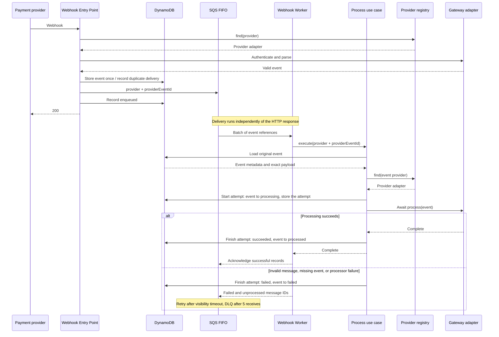

# Webhook processing

The `webhook_worker` Lambda consumes `webhook_events.fifo` and hands each queued event identity to the process use case. The use case loads the original event from DynamoDB, selects its payment gateway through the shared provider registry's `find` method, and awaits the provider's `process` method inside a recorded [processing attempt](#processing-attempts). SQS moves messages that keep failing to the [dead-letter queue](#dead-letter-queue). The worker has no HTTP route and needs no webhook authentication credentials. [Webhook receipt](webhook-receipt.md) uses the registry's `find` method to select those same provider classes for authentication and parsing.

## How it works

| Component | Responsibility |
|---|---|
| SQS driving adapter | Parse each record's JSON, validate it against the worker's schema, process the batch in order, and return partial batch failures |
| Worker controller | Declare its message schema, with `provider` and `providerEventId` as strings that are not blank, and await the process use case with that identity |
| Process use case | Load the stored event, select its provider, and await `process` inside a recorded attempt, rejecting missing events and unknown providers and propagating failures |
| Provider registry | `find` selects providers for both receipt and processing; registrations must be unique |
| Gateway adapters | One class per gateway exposes `authenticate`, `parse`, and `process`; each Lambda calls only the methods of its stage |

Sharing provider classes also shares their constructor dependencies, including the clock and configuration. Each Lambda has its own instances. Credentials are read lazily by `authenticate`, so worker initialization and processing require none of the receipt secrets.

## Delivery and failures

| Setting | Behavior |
|---|---|
| Event source | Terraform maps the FIFO queue to `webhook_worker`, with batches of up to 10 records |
| Partial responses | `ReportBatchItemFailures` allows Lambda to delete completed records and retry the rest |
| FIFO order | A failed record and later records in its message group retry; other groups in the same batch continue, and completed records are acknowledged |
| Visibility timeout | 180 seconds, derived from six times the worker's 30-second timeout |
| Redrive | After 5 receives, SQS moves a failing message to the FIFO dead-letter queue |
| Permissions | Consume only the webhook queue, read events and record attempts and statuses in the webhook events table, and write execution logs |
| Code version | `CODE_VERSION` names the deployed code; see [Deployment](../guides/deployment.md#how-it-works) |
| Attempt deadline | The runtime's remaining execution time fixes one deadline for every attempt in the invocation; see [Invocation timing](code-structure.md#invocation-timing) |
| Local delivery | A poller reads the same Terraform mapping settings, invokes the worker through SAM, and deletes only completed records; see [Development](../guides/development.md#local-functions) |

The retry policy follows AWS's [FIFO partial batch response guidance](https://docs.aws.amazon.com/lambda/latest/dg/services-sqs-errorhandling.html) and [visibility timeout guidance](https://docs.aws.amazon.com/lambda/latest/dg/services-sqs-configure.html). Invalid JSON, messages that do not match the schema, unknown gateways, missing stored events, and repository or processor errors all remain retryable until the message moves to the dead-letter queue; none is silently discarded. A function timeout or initialization failure retries the whole batch.

Failures caught during delivery use the shared [error log fields](code-structure.md#errors), alongside the SQS message context. The worker classifies the following as unexpected, since receipt should have dispatched a valid identity for an existing event:

| Error code | Category | When |
|---|---|---|
| `QUEUE_MALFORMED_MESSAGE` | `queue` | The SQS body is not valid JSON; the error never includes the raw body |
| `QUEUE_INVALID_MESSAGE` | `queue` | The decoded message does not match the worker's schema, such as a missing or blank `provider` or `providerEventId` |
| `WEBHOOK_PROVIDER_NOT_FOUND` | `webhooks` | No registered adapter matches the stored event's provider; receipt shares this error but treats unknown public paths as expected |
| `WEBHOOK_EVENT_NOT_FOUND` | `webhooks` | The queued identity has no stored event |
| `WEBHOOK_EVENT_IN_PROGRESS` | `webhooks` | Another attempt holds the event and has not reached its deadline; since the queue delivers each provider's events one at a time, this should not happen |
| `INTERNAL_SERVER_ERROR` | Unspecified | An unclassified repository or provider failure |

The shared registry raises `WEBHOOK_PROVIDER_ALREADY_REGISTERED` if two adapters have the same name. This is an unexpected initialization failure in either Lambda, so it stops startup before requests or batches are handled.

Storage lookup precedes provider selection. If the queued identity has no stored record, the use case reports `WEBHOOK_EVENT_NOT_FOUND`; provider selection only happens after the record is loaded.

## Processing attempts

Each run of `process` is an attempt, stored with the event and moving its [processing status](data-model/webhook-events.md#processing-status):

| Moment | What is written |
|---|---|
| Start | The event moves to `processing` and names the attempt in `current_attempt_id`, with its deadline in `current_attempt_deadline`; then the attempt item stores its ID, start time, and the deployed `CODE_VERSION` as `handler_version` |
| Success | The attempt records its end time and `succeeded`; the event moves to `processed` |
| Failure | The attempt records its end time, `failed`, and the error's code; the event moves to `failed`, and the error reaches the queue, which retries the message |

- An event that is already `processed` is acknowledged without another attempt, such as when a provider delivers it again after SQS stopped deduplicating it. A redriven event whose last attempt failed starts another attempt.
- Each attempt uses the invocation's fixed deadline, captured when the handler begins from the clock and Lambda's remaining execution time. Loading events and processing earlier messages spend that same time budget, so later attempts in the batch have less time remaining. An attempt that stops without finishing, such as on a function timeout, leaves its event `processing`; the next delivery after the deadline takes it over with a new attempt.
- The start is refused with `WEBHOOK_EVENT_IN_PROGRESS` while another attempt holds the event before its deadline, so the queue retries later.
- An attempt that was taken over still records its outcome on its own item, but never changes the event's status.
- `handler_version` tells which deployed code ran each attempt, so the events a defect affected can be selected for reprocessing.
- Events stored before processing statuses existed start an attempt like enqueued ones, and a `processing` event whose attempt has no deadline can always be taken over.

## Dead-letter queue

After 5 receives, SQS moves a failing message to `webhook_events_dlq.fifo`, which keeps it for 14 days. SQS alone tracks the receive limit and moves messages. A CloudWatch alarm enters `ALARM` when the queue's visible-message metric reports at least one message; an SNS topic can receive notifications when configured for deployment.

- The dead-letter queue is the record of messages waiting for investigation or redrive. An event's DynamoDB status can remain `failed` or `processing` while its message waits there, and a message blocked behind another failed record can reach the queue without its event being attempted.
- Invalid JSON and messages that do not match the schema also reach the dead-letter queue. The worker does not write an event status for them because they may name no stored event.
- To retry, redrive the dead-letter queue to `webhook_events.fifo`, from the SQS console or with `aws sqs start-message-move-task --source-arn <dead-letter queue ARN>`. Redriven messages are delivered again, and the worker starts an attempt for an event whose last attempt failed or passed its deadline.
- Redriven messages join their provider's message group behind newer messages, so they are processed out of receipt order.

## Current scope

The gateway classes currently emit `webhook_routed` logs containing the provider, event ID, and event type. Successful routing acknowledges the queue message; it does not mean a payment, subscription, or financial effect has been applied. The original event remains in DynamoDB for its configured retention period.

Business effects and business idempotency are not implemented. A later delivery of the same event can be processed again, so future effects must be safe to repeat. FIFO preserves receipt order, not the provider's occurrence order; receipt records which event reports each payment's [latest status](webhook-receipt.md#out-of-order-events) and the subscription each payment bills, but processing reads neither yet, and nothing derives a subscription's status from its payments. See [Adding a provider](../guides/adding-a-provider.md) for extending both receipt and processing.
