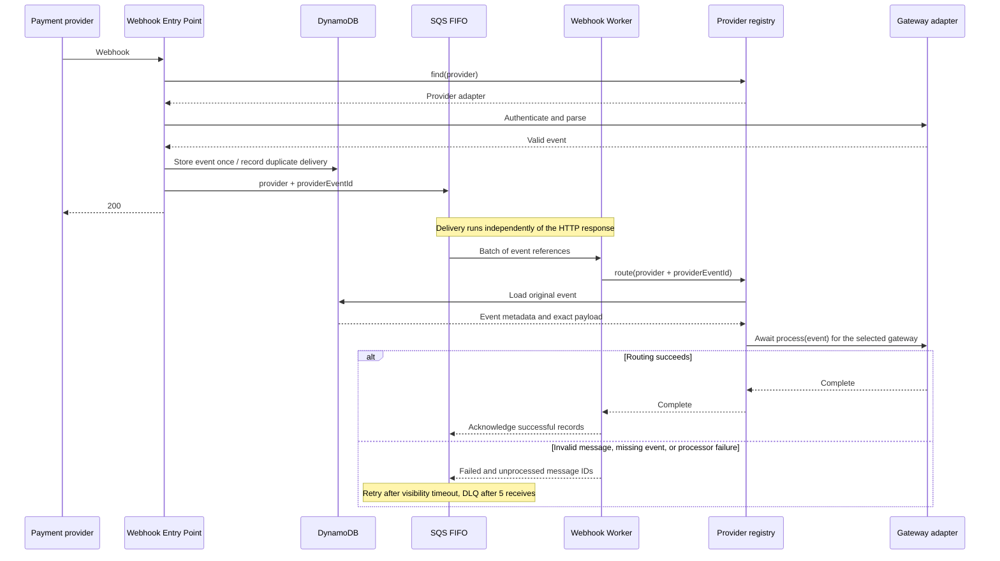

# Webhook processing

The `webhook_worker` Lambda consumes `webhook_events.fifo` and calls `route` on the shared provider registry with each queued event identity. The registry loads the original event from DynamoDB, identifies the payment gateway from it, and awaits the provider's `process` method. The worker has no HTTP route and needs no webhook authentication credentials. [Webhook receipt](webhook-receipt.md) uses the registry's `find` method to select those same provider classes for authentication and parsing.

## How it works

| Component | Responsibility |
|---|---|
| SQS driving adapter | Parse each record's JSON, process the batch in order, and return partial batch failures |
| Worker controller | Validate that `provider` and `providerEventId` are nonempty strings, then await `providerRegistry.route` with that identity |
| Provider registry | `find` selects providers for receipt; `route` loads the stored event, selects its provider, and awaits `process`, rejecting missing events and unknown providers and propagating failures; registrations must be unique |
| Gateway adapters | One class per gateway exposes `authenticate`, `parse`, and `process`; each Lambda calls only the methods of its stage |

Sharing provider classes also shares their constructor dependencies, including the clock and configuration. Each Lambda has its own instances. Credentials are read lazily by `authenticate`, so worker initialization and processing require none of the receipt secrets.

## Delivery and failures

| Setting | Behavior |
|---|---|
| Event source | Terraform maps the FIFO queue to `webhook_worker`, with batches of up to 10 records |
| Partial responses | `ReportBatchItemFailures` allows Lambda to delete completed records and retry the rest |
| FIFO order | On the first failure, the worker stops and reports that record and all subsequent records in the batch; unrelated providers can still run in separate batches |
| Visibility timeout | 180 seconds, derived from six times the worker's 30-second timeout |
| Redrive | After 5 receives, SQS moves a failing message to the FIFO dead-letter queue |
| Permissions | Consume only the webhook queue, read only the webhook events table, and write execution logs |
| Local delivery | A poller reads the same Terraform mapping settings, invokes the worker through SAM, and deletes only completed records; see [Development](../guides/development.md#local-functions) |

The retry policy follows AWS's [FIFO partial batch response guidance](https://docs.aws.amazon.com/lambda/latest/dg/services-sqs-errorhandling.html) and [visibility timeout guidance](https://docs.aws.amazon.com/lambda/latest/dg/services-sqs-configure.html). Invalid JSON, unknown gateways, missing stored events, and repository or processor errors all remain retryable; none is silently discarded. A function timeout or initialization failure retries the whole batch.

Failures caught during delivery use the shared [error log fields](code-structure.md#errors), alongside the SQS message context. The worker classifies the following as unexpected, since receipt should have dispatched a valid identity for an existing event:

| Error code | Category | When |
|---|---|---|
| `QUEUE_MALFORMED_MESSAGE` | `queue` | The SQS body is not valid JSON; the error never includes the raw body |
| `WEBHOOK_MALFORMED_MESSAGE` | `webhooks` | The decoded message lacks a nonempty string `provider` or `providerEventId` |
| `WEBHOOK_PROVIDER_NOT_FOUND` | `webhooks` | The registry cannot route the stored event to a registered adapter; receipt shares this error but treats unknown public paths as expected |
| `WEBHOOK_EVENT_NOT_FOUND` | `webhooks` | The queued identity has no stored event |
| `INTERNAL_SERVER_ERROR` | Unspecified | An unclassified repository or provider failure |

The shared registry raises `WEBHOOK_PROVIDER_ALREADY_REGISTERED` if two adapters have the same name. This is an unexpected initialization failure in either Lambda, so it stops startup before requests or batches are handled.

Storage lookup precedes provider selection. If the queued identity has no stored record, the registry reports `WEBHOOK_EVENT_NOT_FOUND`; provider selection only happens after the record is loaded.

## Current scope

The gateway classes currently emit `webhook_routed` logs containing the provider, event ID, and event type. Successful routing acknowledges the queue message; it does not mean a payment, subscription, or financial effect has been applied. The original event remains in DynamoDB for its configured retention period.

Business effects, processing-attempt records, and business idempotency are not implemented. A later delivery of the same event can route again, so future effects must be safe to repeat. FIFO preserves receipt order, not the provider's occurrence order. See [Adding a provider](../guides/adding-a-provider.md) for extending both receipt and processing.
