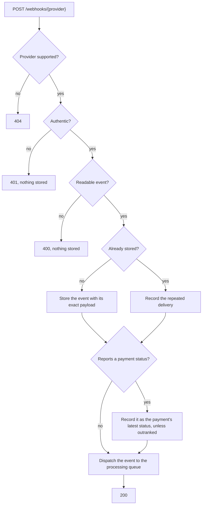
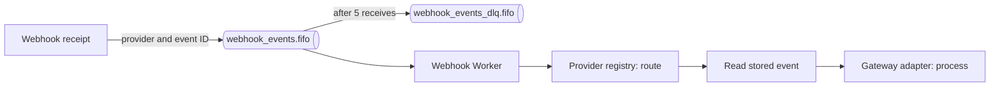

# Webhook receipt

Every payment provider delivers its webhooks to one route, `POST /webhooks/{provider}`, served by one function. The provider named in the path authenticates the request and reads its event through its adapter, the event is recorded once, with its exact payload, in the [webhook events table](data-model/webhook-events.md), and it is dispatched to the [processing queue](#processing-queue). An event that reports a payment's status is ranked against that payment's other events first, so one that arrives late is flagged as [outdated](#out-of-order-events). Receipt applies no business effects, so it acknowledges quickly.

## How it works

- The path segment selects the provider adapter with exactly that name.
- Nothing from an unauthenticated request is parsed or stored.
- The stored event keeps the body exactly as received, so it can be audited and reprocessed.
- A repeated delivery is acknowledged like a new one, because providers retry until they receive a 2xx response, and is recorded with the stored event.
- A repeated delivery is ranked and dispatched again, so an event whose ranking or dispatch failed completes both when the provider retries.
- Events are keyed by provider and event ID, so providers that reuse each other's IDs never collide.

## Responses

| Status | Error code | Category | Kind | When |
|---|---|---|---|---|
| 200 | | | | The event was stored, or a repeated delivery was recorded; the body is `{ "provider", "providerEventId", "duplicate", "outdated" }` |
| 400 | `HTTP_BAD_REQUEST` | `http` | Expected | The body is not valid JSON |
| 400 | `WEBHOOK_MALFORMED_EVENT` | `webhooks` | Unexpected | The request is authentic, but its body is not an event the provider sends, so its adapter likely needs updating |
| 401 | `WEBHOOK_AUTHENTICATION_FAILED` | `webhooks` | Expected | The request does not prove it comes from the provider in its path |
| 404 | `WEBHOOK_PROVIDER_NOT_FOUND` | `webhooks` | Expected | The path names a provider this deployment does not support |
| 500 | `INTERNAL_SERVER_ERROR` | | Unexpected | A failure the application does not define, such as storage or the queue being unavailable, or provider credentials or the queue name missing; the provider retries |

Errors use the response shape and log fields described in [Errors](code-structure.md#errors). An expected error can still signal trouble in volume: a sudden rise in `WEBHOOK_AUTHENTICATION_FAILED` may mean a rotated credential rather than forged requests.

## Out-of-order events

Providers can deliver a payment's events in any order, such as a refund before the payment it reverses. Each event that reports a payment's status is compared with the latest event recorded for the same payment, and the one that ranks higher stays the latest:

1. The status with the higher precedence wins.
2. Between equal precedences, the event that occurred later wins, by the occurrence time its provider gives.
3. Between equal times, the greater event ID wins, so every arrival order ends with the same latest event.

| Precedence | Statuses | Reason |
|---|---|---|
| 3 | `refunded`, `charged_back` | They reverse a payment, and no later event undoes them |
| 2 | `succeeded` | The payment is paid, and only a reversal can follow |
| 1 | `pending`, `overdue`, `failed` | The payment is not paid yet, and these can follow each other, so their occurrence times decide |

Precedence comes first because occurrence times alone cannot order every event: both simulated gateways send them to the second, so a payment and its refund can share one. Each adapter declares the status its event types report in `paymentStatuses`, and receipt looks the event type up there for events about a payment; see [Simulated gateways](../guides/simulated-gateways.md#statuses) for the two gateways' tables.

An event that loses is answered with `outdated: true`. It is still stored and dispatched, because it can carry facts that count, such as the amount of a payment that arrives after its refund; being outdated only means it must not change the payment's status. A repeated delivery is ranked again, which repairs a status that an earlier delivery failed to record, and the latest event delivered again stays the latest. Events that report no status are never ranked and never outdated. Ranking is a single conditional write, so concurrent deliveries for one payment cannot both become the latest; see [Event order](data-model/webhook-events.md#event-order).

Subscription events are never ranked. A subscription's status is derived from the payments that bill it, and each billing cycle is a payment ranked on its own, so a renewal's charge that starts `pending` after the previous one succeeded is not outdated. Receipt stores the subscription each payment names, so processing can find it; see [Subscription status](data-model/webhook-events.md#subscription-status).

## Provider adapters

Each supported provider has one adapter that implements the `WebhookProvider` port. Receipt calls the registry's `find` method using the HTTP path, then calls `authenticate` and `parse` on that adapter. The [worker](webhook-processing.md) calls the registry's `route` method with the queued event identity; the registry loads the stored event, selects the provider, and awaits `process` in the worker's own Lambda execution environment.

| Adapter member | Responsibility |
|---|---|
| `name` | The provider's path segment, also recorded with each of its events |
| `authenticate` | Proves the request comes from the provider, checking its signature or credentials against the body exactly as received |
| `parse` | Reads the event ID, event type, occurrence time, affected payment or subscription, and the subscription a payment bills, or reports that the body is not one of the provider's events |
| `paymentStatuses` | The payment status each of the provider's status-reporting event types reports; the adapter lists those types as the port's type argument, so type checking requires a status for each |
| `process` | Receives the stored event from the worker; receipt never calls it |

Providers differ in authentication, vocabulary, and payload formats; their adapters absorb those differences, so the rest of the system sees one event model. See [Adding a provider](../guides/adding-a-provider.md), and [Simulated gateways](../guides/simulated-gateways.md) for two providers with deliberately different shapes.

## Processing queue

Receipt hands each stored event to processing through an SQS FIFO queue, `webhook_events.fifo`, with a FIFO dead-letter queue, `webhook_events_dlq.fifo`. Terraform provisions both and gives the webhook function the queue's name in `WEBHOOK_EVENTS_QUEUE_NAME`.

| Setting | Value | Effect |
|---|---|---|
| Message body | `{ "provider", "providerEventId" }` | Processing reads the stored event, so the table stays the single source of truth and payload size never matters |
| Message group | The provider name | Each provider's events are delivered in receipt order; separate groups allow concurrent batches |
| Deduplication ID | A digest of the provider and event ID | SQS drops a repeated dispatch within five minutes; later dispatches can route again, so future business effects must be idempotent |
| Redrive | To the dead-letter queue after 5 receives | A message that keeps failing stops holding back its provider's later events |
| Retention | Four days, the SQS default; 14 days in the dead-letter queue | FIFO messages get a new enqueue time when moved to the dead-letter queue |

## Limitations

- Bodies must be JSON; other formats are rejected with 400 before reaching the provider adapter.
- Every provider's credentials are validated together, so one missing credential answers every provider's webhooks with 500 until it is configured.
- The [worker](webhook-processing.md) consumes and routes events to gateway-specific classes; those classes currently log routing without applying business effects.
- One message group per provider means each provider's events are processed one batch at a time, and a failing message holds back its provider's later events until it moves to the dead-letter queue.
- The queue orders events by receipt, not by when the provider says they occurred; ranking flags the late ones, but processing does not read the flag yet.
- Subscription events are not ranked, and nothing derives a subscription's status from its payments yet.
- The latest status reflects the events received so far: a refund whose payment never arrives stays the latest, and nothing detects the missing payment yet.
