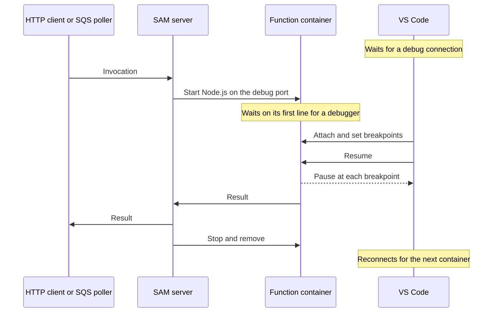

# Debugging

Stop at breakpoints in the TypeScript sources under `src/` while the functions run in their local SAM containers, using the JavaScript debugger built into VS Code. See [Development](development.md) for the local environment itself and [Testing](testing.md) for debugging-free checks.

## Requirements

| Requirement | Used for |
|---|---|
| The [development requirements](development.md#requirements) | Running the local environment |
| [VS Code](https://code.visualstudio.com/) | Attaching to the functions; its built-in JavaScript debugger needs no extension |
| Free local ports 9229 and 9230 | Debug connections to HTTP functions and queue workers |

## Setup

Complete the [development setup](development.md#setup). The debug configurations are part of the repository: [`.vscode/launch.json`](../../.vscode/launch.json) defines the attach configurations, and [`.vscode/tasks.json`](../../.vscode/tasks.json) defines the task that starts the environment.

## How it works

`npm run dev:debug` runs the same script as `npm run dev` with `DEV_DEBUG=1`. VS Code attaches to the SAM servers, not to a long-running process: every invocation runs in a new container, and the debugger follows them one after another.

### What a debug run changes

| Part | Normal run | Debug run |
|---|---|---|
| Bundles | Minified without a source map, as deployed | Unminified, with an inline source map, and named by their local path |
| SAM servers | Run invocations concurrently and stop functions at their timeout | Start each function's Node.js waiting for a debugger, run one invocation at a time, and never stop a function at its timeout |
| Debug ports | None | 9229 on the HTTP server and 9230 on the Lambda server, which runs the queue workers |
| Local SQS poller | Gives up on an invocation after a fixed time | Waits for each invocation, however long it is paused |
| Stopping | SIGTERM stops SAM | SIGHUP stops SAM, since SIGTERM no longer does once SAM has debugged an invocation; containers still waiting for a debugger are then removed |

### How breakpoints find the code

SAM mounts each function's bundle at `/var/task` in its container, a path that does not exist on the host. Node.js does not pause while it reads the source map of a CommonJS module, so the debugger must place breakpoints before the bundle loads, from the files it can read locally.

1. A debug bundle ends with a `//# sourceURL` comment holding its path under `dist/bundles/`, so Node.js reports the bundle by that local path instead of `/var/task/index.js`.
2. On attach, VS Code reads the source maps of the bundles under `dist/bundles/` and maps each breakpoint in `src/` to a line in every bundle that includes that file.
3. VS Code sets those breakpoints by the bundles' local paths and resumes; Node.js binds them as soon as the bundle loads.
4. The source map paths are relative to the bundle, so paused frames open the TypeScript files in the workspace.

A breakpoint in shared code, such as a repository or the kernel, binds in every function whose bundle includes it.

### Attach configurations

Both attach configurations share their settings and differ only in their port.

| Setting | Value | Why |
|---|---|---|
| `port` | 9229 for **Attach to HTTP functions**, 9230 for **Attach to queue workers** | Must match the debug ports the dev script gives the SAM servers |
| `timeout` | `0` | Waits for the first invocation, however long it takes |
| `restart` | `true` | Reconnects after each container exits, so every later invocation is debugged too |
| `continueOnAttach` | `true` | Resumes the function, which waits on its first line for a debugger |
| `outFiles` | `dist/bundles/**/*.js` | Bundles whose source maps place the breakpoints |
| `skipFiles` | Node.js internals and `/var/runtime/**` | Steps over the Lambda runtime and into project code only |

The **Debug local dev** compound runs the **Local dev with debugging** task before attaching. The task runs `npm run dev:debug` in the background, and VS Code attaches once the script prints that each invocation waits for a debugger. When the task is already running, VS Code attaches at once without rebuilding. Stopping the compound detaches both configurations and leaves the environment running.

## Usage

| Task | Command or action |
|---|---|
| Start the environment and attach | In **Run and Debug**, pick **Debug local dev** and press F5 |
| Stop at a line | Set a breakpoint in a TypeScript file under `src/`, then send a request |
| Send a webhook to debug | `npm run simulate -- <scenario>` in another terminal, such as `npm run simulate -- duplicate-delivery`; see [Simulated gateways](simulated-gateways.md#usage) |
| Detach | Shift+F5; the environment keeps running, and F5 attaches to it again |
| Pick up code changes | Run **Tasks: Restart Running Task** and pick **Local dev with debugging**; the attached debugger reconnects to the rebuilt functions |
| Stop the environment | Run **Tasks: Terminate Task**, or press Ctrl+C in the task terminal |
| Debug an environment started in a terminal | Run `npm run dev:debug`, then start **Attach to HTTP functions** and **Attach to queue workers** |
| Serve the API on another port | `npm run dev:debug -- --port 3001`; the debug ports stay the same |

Keep both configurations attached while debugging only one side: an invocation on a server without a debugger waits indefinitely, and a waiting worker also holds up its queue.

## Limitations

- Every invocation waits until a debugger attaches, so requests and queue messages hang while VS Code is detached.
- Each SAM server runs one invocation at a time, so scenarios that depend on concurrency, such as concurrent bursts, do not reproduce it.
- Clients keep their own timeouts while a function is paused, such as the simulator's acknowledgment timeouts, so their scenarios can fail.
- The Lambda context still reports the configured timeout, so time-based logic, such as processing attempt deadlines, treats a paused invocation as expired once that time passes.
- Stack traces from a debug run name the bundle's local path instead of `/var/task/index.js`.
- The debug ports are fixed, so only one debug run can use them per machine, in line with one local environment per machine.
- Only local functions can be debugged; deployed functions cannot.
