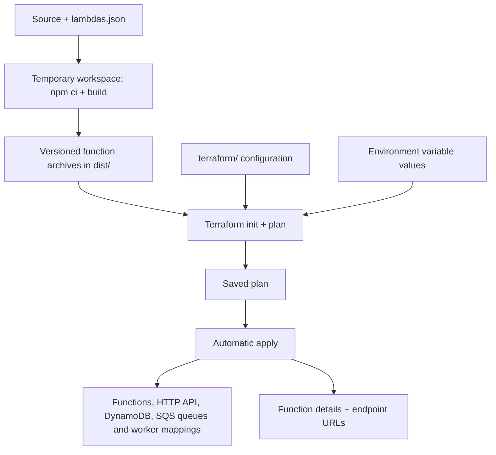

# Deployment

Build every registered function and deploy it to AWS, with its HTTP routes, DynamoDB tables, SQS queues, and event source mappings. See [Development](development.md) for local runs and [Testing](testing.md) for automated checks.

## Requirements

| Requirement | Used for |
|---|---|
| Node.js 24 and npm | Installing build tools and building the functions |
| Bash and `zip` | Running the deployment and packaging functions |
| Git | Naming the deployed code version after the current commit |
| Terraform matching the `required_version` in `terraform/` | Planning and applying infrastructure changes |
| AWS credentials and network access | Accessing the state backend and managing AWS resources |
| An existing S3 bucket for the state backend | Storing Terraform state |

## Setup

1. Install the tools above and configure credentials for the target AWS account.
2. Review the state backend, provider region, and resource names in the Terraform configuration in `terraform/`.
3. Ensure the backend bucket exists before initialization. The configuration also manages this bucket, so an existing bucket must be tracked in this Terraform state before applying.
4. Set the values of the functions' environment variables that Terraform declares without a default, such as provider credentials; `npm run deploy` sets `CODE_VERSION` itself. Planning fails while one is missing, and Terraform state stores the values in plain text. Keep them: every deployment must use the same ones, and the [delivery simulator](simulated-gateways.md) needs them to reach a deployed API. Generate secrets with `openssl rand -hex 32`.

   | Option | How |
   |---|---|
   | Secrets file | Copy [`terraform/secrets.auto.tfvars.example`](../../terraform/secrets.auto.tfvars.example) to `terraform/secrets.auto.tfvars` and fill it in; Terraform loads it automatically, and git ignores it |
   | Environment | Export each variable as `TF_VAR_<NAME>`; a secrets file takes precedence |

To receive dead-letter queue alarm notifications, set `TF_VAR_ALARM_NOTIFICATION_TOPIC_ARN` to an existing SNS topic ARN before deployment. Without one, the alarm state remains visible in CloudWatch.

## How it works

`npm run deploy` builds in a temporary workspace and uses [`lambdas.json`](../../lambdas.json) to select the functions. The workspace holds only what the functions are built from (the Lambda source, the build tooling, and the package files), so local tooling and the simulator never affect a deployment:



**The entire saved plan is applied automatically**, including infrastructure changes beyond function code. The deployment does not pause for review or run the tests.

| Artifact | Behavior |
|---|---|
| `dist/<name>_<version>.zip` | One archive per function containing `index.js`; kept after deployment |
| Version suffix | The code version's deploy time plus a unique suffix, passed as `lambdasVersion` |
| Code version | The UTC deploy time and the commit SHA, such as `20261017110316-339fc51a2130`, from `scripts/deploy/code-version.sh`; versions sort in deploy order and name the commit the code came from. Passed as `CODE_VERSION` to the health function and the worker |
| Temporary workspace and saved plan | Removed when the deployment ends, including on failure |
| Existing local dependencies and bundles | Preserved |

## Usage

Run the [automated checks](testing.md), then deploy from the repository root:

```bash
npm run deploy
```

Commit the changes to the built files first, and preferably push them, so the code version names code anyone can check out. Deployment stops while `src/`, `build/`, the package files, `tsconfig.json`, or `lambdas.json` have uncommitted changes. `npm run deploy -- --allow-dirty` deploys them anyway and ends the code version in `-dirty`. Run `bash scripts/deploy/code-version.sh` to see the version a deployment would get.

To review the infrastructure changes first, run `terraform -chdir=terraform plan -var=lambdasVersion=local -var=CODE_VERSION=local` after `npm run dev` has packaged the local archives. The deployment stops on the first failure; inspect a fresh plan before retrying a failed infrastructure change.

### Deployed resources

| Resource | Details |
|---|---|
| Functions | One Node.js 24 Lambda per registry entry, running `index.handler` with the IAM role its entry selects and logging to CloudWatch in JSON at `INFO` and above; see [Adding a Lambda](adding-a-lambda.md) and [Logging](../architecture/code-structure.md#logging) |
| Environment variables | Per function, from the values set during setup and from the resources they describe, such as the queue name |
| HTTP API | API Gateway HTTP API with an automatically deployed `$default` stage, and one route, proxy integration, and invocation permission per HTTP function; queue workers have no HTTP endpoint |
| DynamoDB tables | On-demand tables with their indexes and TTL; see the [data model](../architecture/data-model/) |
| SQS queues | The webhook events FIFO queue and its dead-letter queue; see the [processing queue](../architecture/webhook-receipt.md#processing-queue) |
| Dead-letter queue alarm | Enters `ALARM` when CloudWatch reports visible messages; see [Webhook processing](../architecture/webhook-processing.md#dead-letter-queue) |
| SQS event source mappings | Invoke the webhook worker with partial batch responses; its role permits queue consumption, stored event reads, and execution logs |
| State bucket | The S3 bucket holding the Terraform state, managed by the same configuration |

Terraform uploads each archive directly to Lambda and tracks its content hash, so only changed functions are updated.

### Calling the API

Inspect the deployed URLs, functions with their package and memory sizes, and queues:

```bash
terraform -chdir=terraform output lambda_endpoints
terraform -chdir=terraform output lambda_functions
terraform -chdir=terraform output -raw api_endpoint
terraform -chdir=terraform output webhook_events_queue
```

Call each route with the method and path registered in `lambdas.json`, substituting any path parameters. URLs have no stage prefix.

| API behavior | Current configuration |
|---|---|
| Authentication | None at API Gateway; a function that needs it authenticates requests itself, as [webhook receipt](../architecture/webhook-receipt.md) does |
| Event format | API Gateway payload `2.0` |
| Integration timeout | 30 seconds, even if the function timeout is longer |
| Unmatched route | HTTP 404 |

HTTP functions must respond within the integration timeout; longer work needs asynchronous processing. The webhook worker runs asynchronously from SQS; see [Webhook processing](../architecture/webhook-processing.md).
