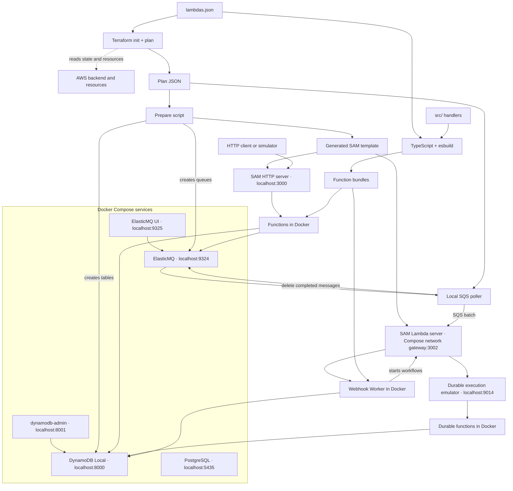

# Development

Run the API, worker, durable workflows, databases, and queues on your machine, from the same Terraform definitions that deploy them. See [Testing](testing.md) for automated checks and [Deployment](deployment.md) for releases to AWS.

## Requirements

| Requirement | Used for |
|---|---|
| Node.js 24 and npm | Building |
| [AWS SAM CLI](https://docs.aws.amazon.com/serverless-application-model/latest/developerguide/install-sam-cli.html) | Running the functions; verified with SAM 1.167.0 |
| Docker with its daemon running, and Docker Compose v2 | Function containers and the local services |
| Terraform matching the `required_version` in `terraform/`, Bash 4.3 or newer, and `zip` | Planning and packaging |
| AWS credentials and network access | Reading the Terraform state, and AWS services that are not emulated locally |
| Free local ports 3000, 3002, 5435, 8000, 8001, 9014, 9324, and 9325 | The API, Lambda invocation server, PostgreSQL, DynamoDB Local, dynamodb-admin, SAM's durable execution emulator, ElasticMQ, and its UI |

Building and testing need only Node.js and npm.

## Setup

1. Install the tools above and start Docker.
2. Configure AWS access as in the [deployment setup](deployment.md#setup). Local runs read the Terraform state but never change AWS resources.
3. Install the dependencies from the repository root:

   ```bash
   npm ci
   ```

## How it works

[`lambdas.json`](../../lambdas.json) registers the functions and their routes, and [`compose.dev.yaml`](../../compose.dev.yaml) defines the local services. `npm run dev` runs both from one Terraform plan:



1. The build bundles each function. Docker Compose starts DynamoDB Local without tables and [ElasticMQ](https://github.com/softwaremill/elasticmq), an SQS-compatible server, without queues, each with its web UI, and PostgreSQL with an empty `history` database.
2. Terraform plans with local archive names and local secrets, and exports the plan as JSON. The plan is **never applied**: it only serves as a machine-readable description of the tables, queues, functions, and routes defined in `terraform/`.
3. A script creates the planned tables in DynamoDB Local and the planned queues in ElasticMQ, and generates a SAM template for the planned functions and routes. See [Local tables](#local-tables), [Local queues](#local-queues), and [Local functions](#local-functions).
4. SAM serves HTTP routes and a separate Lambda invocation endpoint, running functions in containers attached to the Compose network. A local poller consumes ElasticMQ and invokes workers through that endpoint, and functions start durable workflows through it, which SAM runs with its durable execution emulator. The template is temporary, so no SAM template is maintained.

## Usage

Start the API and queue consumers from the repository root:

```bash
npm run dev
```

| Task | Command or action |
|---|---|
| Stop the API and workers | Ctrl+C stops both SAM servers and the poller; the local services keep running |
| Pick up code, registry, table, or queue changes | Stop and rerun `npm run dev` |
| Serve the API on another port | `npm run dev -- --port 3001` |
| Use another Lambda invocation port | `DEV_LAMBDA_PORT=3003 npm run dev`; separate from the HTTP `--port` |
| Debug the functions with breakpoints | Run **Debug local dev** in VS Code, or `npm run dev:debug` and attach; see [Debugging](debugging.md) |
| Observe worker routing | Watch `webhook_routed` logs in the terminal after sending a webhook |
| Observe access grants | Watch `subscription_access_granted` logs after sending a succeeded payment that names its subscription |
| Follow durable executions | `npm run dev:workflows` in another terminal shows each execution's start, checkpoints, and result from SAM's durable execution emulator; `sam local execution history <arn>` lists an execution's steps |
| Browse and edit items | Open <http://localhost:8001> |
| Replay the delivery scenarios | `npm run simulate` in another terminal; see [Simulated gateways](simulated-gateways.md#usage) |
| Query DynamoDB Local from the host | Add `--endpoint-url http://localhost:8000` to AWS CLI commands, such as `aws dynamodb scan --table-name <table> --endpoint-url http://localhost:8000` |
| Browse queues and their messages | Open <http://localhost:9325>; the message counts refresh live, and receiving a message counts toward its queue's redrive limit |
| Query the history database | `docker compose -f compose.dev.yaml exec postgres psql -U history_admin history`, or connect a client to `localhost:5435` with the local credentials in [`compose.dev.yaml`](../../compose.dev.yaml) |
| Query ElasticMQ from the host | Add `--endpoint-url http://localhost:9324` to AWS CLI commands, such as `aws sqs list-queues --endpoint-url http://localhost:9324` |
| Stop the local services | `docker compose -f compose.dev.yaml down`; queued messages are lost |
| Erase the local tables and items | `npm run dev:reset-db`, then rerun `npm run dev` to create the tables again |
| Erase all local data | `docker compose -f compose.dev.yaml down --volumes` |
| Build without starting the API | `npm run build` |
| Type-check the local tooling and simulator too | `npm run typecheck` |

Run one local environment per machine; checkouts share the local services and queue messages. The first run downloads the function runtime and service images, and the first workflow downloads the durable execution emulator.

### Local tables

| Behavior | Detail |
|---|---|
| Source | Every `aws_dynamodb_table` in the Terraform plan, so local tables follow `terraform/` without a copy of their definitions |
| Copied settings | Keys, attribute types, global and local secondary indexes, and TTL; capacity, backups, and other settings that do not change request behavior are left out |
| Missing table | Created |
| Table that matches its definition | Left untouched, with its items |
| Table whose keys, indexes, or TTL changed | Deleted and created again, which removes its items |
| Storage | A Docker volume, so items survive restarts until the local data is erased |
| Credentials and region | Shared: DynamoDB Local runs with `-sharedDb`, so the functions, the AWS CLI, and dynamodb-admin see the same tables whatever access key or region they use |

Tables removed from Terraform stay in DynamoDB Local until its data is erased.

### Local queues

| Behavior | Detail |
|---|---|
| Source | Every `aws_sqs_queue` in the Terraform plan |
| Copied settings | Name, FIFO and content-based deduplication, visibility timeout, delivery delay, receive wait time, and the redrive policy; retention, encryption, access policies, and the high-throughput settings are left out |
| Dead-letter queue | Terraform exports target names and receive limits, so redrive points to the local dead-letter queue even before deployment |
| Missing queue | Created |
| Queue that matches its definition | Left untouched, with its messages |
| Queue whose settings changed | Deleted and created again, which removes its messages |
| Storage | Memory: queues and messages are lost when the local services stop, and `npm run dev` creates the queues again |
| Queue URLs | Follow the host of each request, so functions get URLs on the Compose network and host tools get `localhost` URLs |

Queues removed from Terraform stay in ElasticMQ until the local services stop.

### Local functions

| Behavior | Detail |
|---|---|
| Source | Every `aws_lambda_function` and `aws_apigatewayv2_route` in the Terraform plan; queue consumers use `local_sqs_consumers`, an output derived from event source mappings |
| Copied settings | Name, handler, runtime, memory, timeout, environment variables, and durable configuration; the code is the function's bundle in `dist/bundles/`, which Terraform uploads zipped |
| Routes | Each route's method and path run the function with the same registry key, with payload format `2.0`, as deployed |
| Queue triggers | The poller receives batches from ElasticMQ and invokes SAM; completed records are deleted and failed records return after visibility timeout, then redrive after the receive limit |
| Undeployed functions, routes, and mappings | Run locally using planned names, without deployed ARNs |
| Code version | `CODE_VERSION` is `local`, from [`terraform/secrets.local.tfvars`](../../terraform/secrets.local.tfvars), so local runs never pass for a deployed commit |
| Secrets | Local values from [`terraform/secrets.local.tfvars`](../../terraform/secrets.local.tfvars), such as the [simulated gateways'](simulated-gateways.md#setup); they take precedence over the deployment secrets file, which never applies to a secret they set |
| DynamoDB, SQS, and Lambda endpoints | Every function gets `AWS_ENDPOINT_URL_DYNAMODB`, `AWS_ENDPOINT_URL_SQS`, and `AWS_ENDPOINT_URL_LAMBDA`, so the AWS SDK sends DynamoDB requests to DynamoDB Local, SQS requests to ElasticMQ, and workflow starts to SAM, and the code needs no local-only configuration |
| Lambda invocation server | Listens on the Compose network's gateway address instead of `localhost`, so both the poller and the function containers reach it |
| Durable functions | Run with SAM's durable execution emulator, a container SAM starts on first use and leaves running for the next run, whose state lives in `.durable-executions-local/`; SAM points their own checkpoint calls at it |

### Local limitations

- The local poller processes one batch at a time per mapping; it reproduces acknowledgement and retry behavior, not AWS poller scaling or concurrency between message groups.
- DynamoDB Local differs from the service in some behaviors, such as throughput limits; see the [DynamoDB Local usage notes](https://docs.aws.amazon.com/amazondynamodb/latest/developerguide/DynamoDBLocal.UsageNotes.html).
- ElasticMQ implements the SQS API but differs in some behaviors; for example, a deleted queue's name can be reused at once, while SQS requires a 60-second wait.
- ElasticMQ cannot redrive its dead-letter queue: listing message move tasks stops the local SQS server. To retry a dead-lettered message locally, send its body again to `webhook_events.fifo` with the same message group and a new deduplication ID, which is what a redrive delivers.
- The durable execution emulator does not deduplicate execution names, so starting the same event's workflow again runs it again; the grant rewrites the same items, so the outcome is the same.
- Calls to other AWS services reach AWS. Other services and IAM permissions are not emulated.
- Only the method and path of API Gateway routes apply locally; integration settings, such as the 30-second integration timeout, do not. A route without a method and path, such as `$default`, stops `npm run dev`.
- SAM answers an unmatched route with 403 (`Missing Authentication Token`); the deployed HTTP API answers 404.
- An environment variable that has no default, such as a new secret, needs a local value in `terraform/secrets.local.tfvars`. Without one, `npm run dev` uses the deployed value when the deployment secrets file or `TF_VAR_<NAME>` sets it, and otherwise fails to plan.

## Build output

TypeScript checks types, and esbuild bundles each function and its dependencies, except the AWS SDK, into one minified CommonJS file. esbuild resolves the `tsconfig.json` path aliases, compiles decorators, and keeps class names so dependency injection errors stay readable.

| Artifact | Purpose |
|---|---|
| `dist/bundles/<name>/index.js` | Built function; replaced on each build, and unminified with a source map in [debug runs](debugging.md) |
| `dist/<name>_local.zip` | Archive the local Terraform plan requires; rebuilt by `npm run dev` |
| `dist/<name>_<version>.zip` | Deployment archive; preserved by local builds |

The build tooling in `build/` and the scripts in `scripts/` are TypeScript that Node.js runs directly by stripping its types, with no compile step. `build/tsconfig.json` type-checks the build tooling separately from the function code and allows only syntax that Node.js can strip.

Node.js built-ins and AWS SDK v3 packages (`@aws-sdk/*`) remain runtime imports, because the Lambda Node.js runtime provides them; the SDK is a development dependency, used only for type checking and tests. The deployed SDK version is the one the runtime ships, so code must not rely on SDK features newer than it. The builder rejects extra output, any other external import, and unsupported dynamic imports or `require` calls. Native addons, runtime files, and computed imports may need different packaging.
